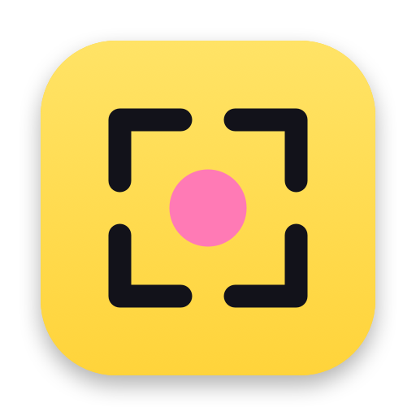
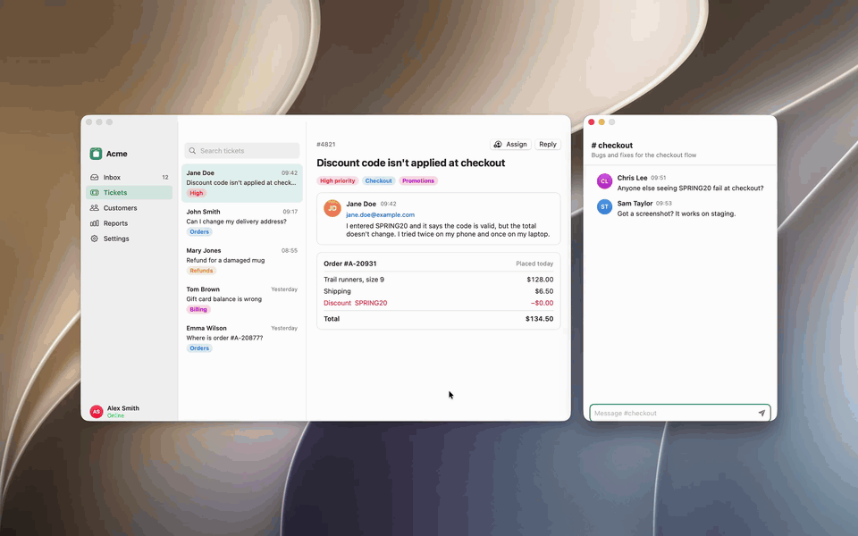
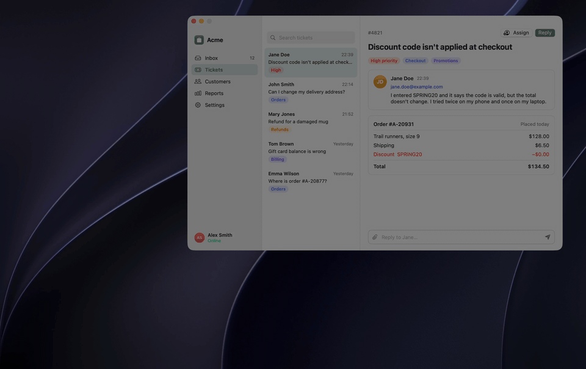
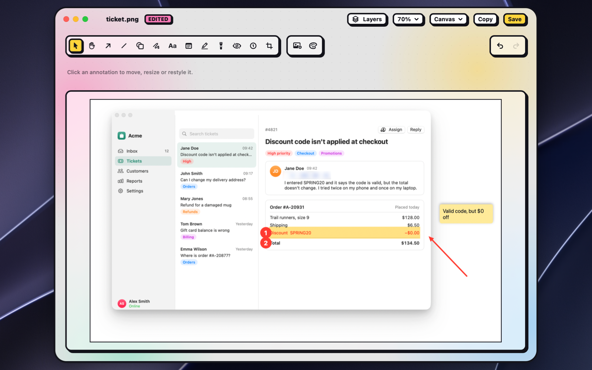
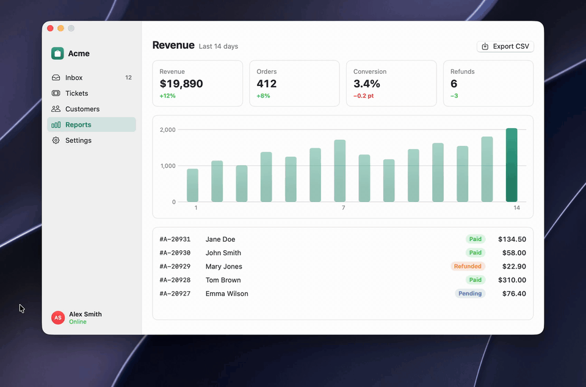
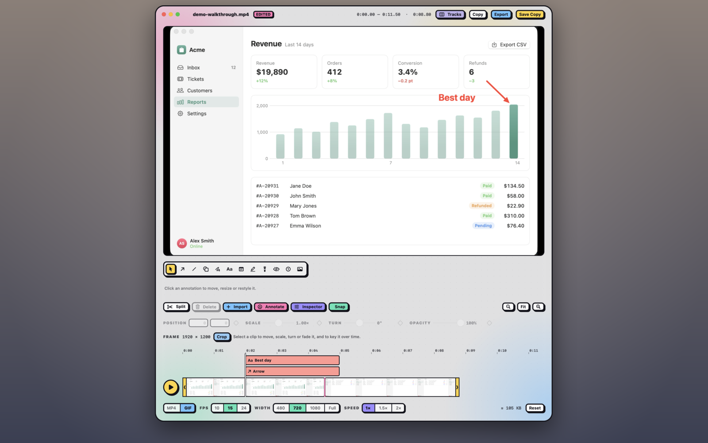
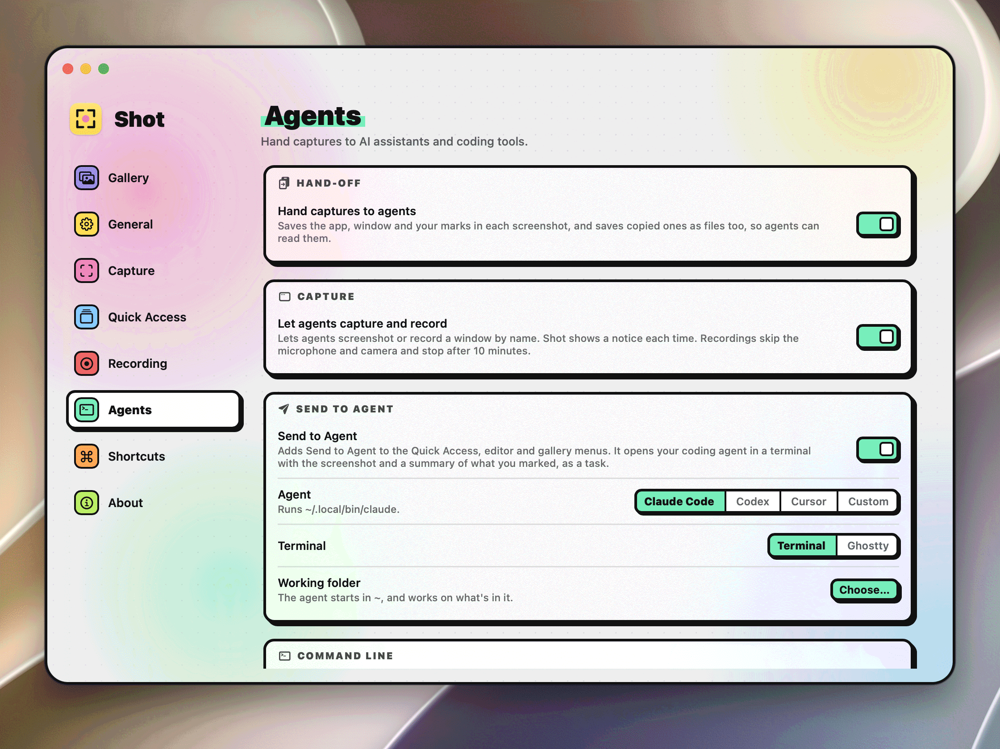
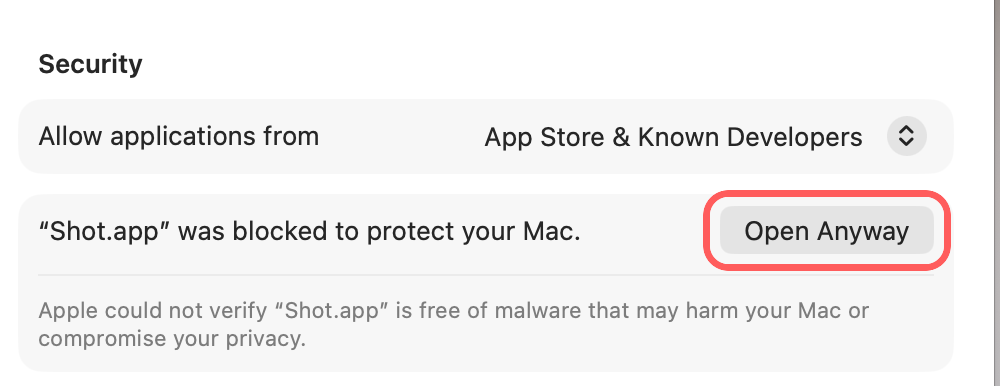

<p align="center">
  
</p>

<h1 align="center">Shot <sup>beta</sup></h1>

<p align="center">
  Screenshots, annotations, and screen recordings for macOS, from the menu bar.<br>
  Free, open source, and private: no account, no cloud, no analytics.
</p>

<p align="center">
  <a href="https://github.com/LorcanChinnock/shot/releases/latest"></a>
  
  
  <a href="LICENSE"></a>
  <a href="https://github.com/sponsors/LorcanChinnock"></a>
</p>

<p align="center">
  <a href="https://github.com/LorcanChinnock/shot/releases/latest"><b>Download Shot for macOS</b></a>
</p>

<p align="center">
  
</p>

### Capture and Quick Access

Pick an area on a frozen screen with a magnifier, or a window or the full screen. Shot copies and saves it as soon as you let go, and a card in the corner lets you annotate it, save it somewhere else, pin it above your other windows, or drag it straight into another app. To copy the text in an area instead, give **Copy Text** a shortcut.



### Annotate anything

Arrows, sticky notes, blur and pixelate, a spotlight, a pen and more, with room to annotate outside the screenshot and to combine several images on one canvas.



### Record your screen, and yourself

Record an area, a screen or a window to MP4, with your microphone, system audio, and a round camera bubble.



### Trim and export to GIF

Trim a recording, cut sections out, crop it, draw over it, add music or other clips, and export an MP4 or a GIF at the frame rate, width and speed you choose.



### Works with AI agents

Circle the bug, copy, and paste it into Claude Code, Codex or Cursor: your arrows and notes show the agent exactly where to look. Through Shot's MCP server and `shot` command, an agent can also read your captures, the text in them, what you marked and what you said while recording, find one by the text in it, hide the emails, tokens and card numbers in them, edit them as you would in the editors with every layer still live (crop, pad, style, mark up and combine screenshots, or cut, speed up, mark up and shrink recordings to fit a size limit), wait for your next one, ask you to select something on screen, screenshot or record a window such as the Simulator, and compare two screenshots to see what changed; see [Using Shot with AI agents](https://shot.lorcanchinnock.com/docs/using-shot-with-ai-agents/).



## Install

Shot needs macOS 15 or later and an Apple Silicon or Intel Mac. Intel support is best effort: the app is built for Intel but not tested on it, so please report anything that breaks.

Shot is in English, German, French, Spanish, Italian, Brazilian Portuguese, Japanese, Korean and Simplified Chinese. It uses your Mac's language, or the one you pick for Shot in **System Settings › General › Language & Region › Applications**.

**With [Homebrew](https://brew.sh):**

```sh
brew install lorcanchinnock/tap/shot
```

**Or by hand:** download `Shot-v<version>.zip` from the [latest release](https://github.com/LorcanChinnock/shot/releases/latest), unzip it, and move **Shot.app** to Applications.

### First launch

1. Open Shot from Applications. Releases aren't notarized by Apple yet, so macOS says it can't verify Shot. Click **Done**.
2. In **System Settings › Privacy & Security**, scroll down to the message about Shot, click **Open Anyway**, then confirm. You only do this once.

   

3. In Shot's welcome window, click **Grant**, then **Open System Settings** in the macOS prompt, and turn on Shot. Back in Shot's window, click **Relaunch**: macOS applies the permission only after a relaunch.
4. Choose whether Shot takes over ⌘⇧3 to ⌘⇧5 (macOS gets them back when Shot quits) and opens at login, then click **Continue**.
5. Shot now lives in the menu bar. Press ⌘⇧4 and drag out an area to take your first screenshot; the window shows a few tips once it's done. See [First launch](https://shot.lorcanchinnock.com/docs/first-launch/) for more.

Shot updates itself once you allow it to; see [Updates](https://shot.lorcanchinnock.com/docs/updates/). To uninstall, see [Removing Shot](https://shot.lorcanchinnock.com/docs/removing-shot/), or quit Shot and run `brew uninstall --zap shot` if you used Homebrew.

## Shortcuts

| Shortcut | Action |
|---|---|
| ⌘⇧3 | Capture the full screen |
| ⌘⇧4 | Capture an area. Press Space to pick a window instead. |
| ⌘⇧5 | Record an area. Press Space to pick a window, or Return for the full screen. |

Shot takes these keys over from macOS. To keep the macOS screenshot tool, and for every other shortcut, see [Keyboard shortcuts](https://shot.lorcanchinnock.com/docs/keyboard-shortcuts/).

## More

- **[User guide](https://shot.lorcanchinnock.com/docs/):** every feature, shortcut and setting, plus the `shot://` URL scheme.
- **[Privacy](https://shot.lorcanchinnock.com/docs/privacy/):** no analytics; the network is used only to check for updates, after you agree.
- **[Contributing](CONTRIBUTING.md):** build from source, run the tests, and send a change.
- **[Sponsor](https://github.com/sponsors/LorcanChinnock):** Shot is free; sponsoring helps pay to notarize it.
- **[License](LICENSE):** free software under the GNU General Public License v3.0.
- **[Acknowledgements](Resources/Acknowledgements.txt):** Shot updates itself with [Sparkle](https://sparkle-project.org), under the MIT license.
- **[Security](SECURITY.md):** how to report a vulnerability.
