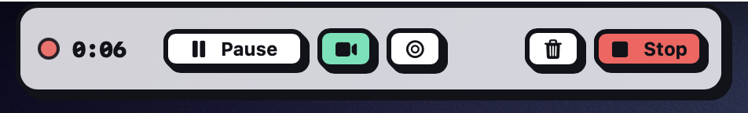
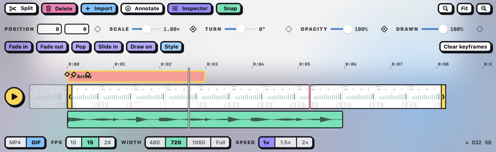
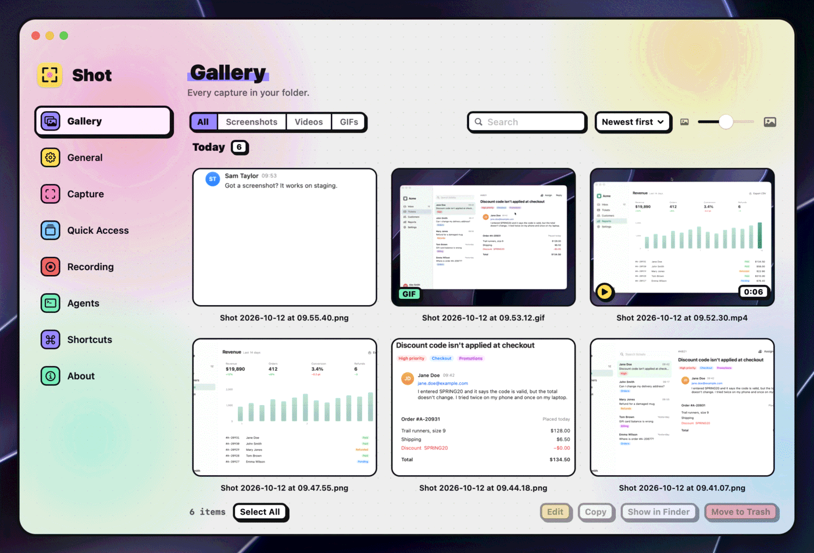

# Using Shot

The full guide to Shot. For a quick introduction, see the [overview](../README.md).

- [First launch](#first-launch)
- [Screenshots](#screenshots)
- [Quick Access](#quick-access)
- [Screen recording](#screen-recording)
- [Annotation editor](#annotation-editor)
- [Video editor](#video-editor)
- [Gallery](#gallery)
- [Using Shot with AI agents](#using-shot-with-ai-agents)
- [Keyboard shortcuts](#keyboard-shortcuts)
- [URL scheme](#url-scheme)
- [Settings](#settings)
- [Languages](#languages)
- [Updates](#updates)
- [Privacy](#privacy)
- [Troubleshooting](#troubleshooting)
- [Removing Shot](#removing-shot)

## First launch

The first time you open Shot, a welcome window takes about 30 seconds, in three steps. Close it at any step to skip the rest.

1. **Screen Recording access.** macOS requires it for every capture. Click **Grant**, or **Open System Settings**, and turn on Shot under **Screen & System Audio Recording**. Once you've been to System Settings, the window asks you to **Relaunch**, since macOS applies access only after a relaunch. Then the window carries on. If Shot already has access, this step is skipped.
2. **Make it yours.** **Use Shot for ⌘⇧3 to ⌘⇧5** is on: macOS's own screenshot shortcuts turn off while Shot runs, and come back when it quits. Turn it off to keep them, and Shot uses ⌃⇧3, ⌃⇧4 and ⌃⇧5 instead. **Open Shot at login** is ticked, so your shortcuts work after a restart. **Continue** applies both. If you close the window here instead, macOS keeps its shortcuts and Shot isn't added to your login items. The **Agents** button opens [Settings › Agents](#using-shot-with-ai-agents), for Claude Code, Codex or Cursor.
3. **Try it.** Press your area shortcut and drag out any area. Once the capture is done, the window comes back with a few tips, and **Done** closes it. **Skip** closes it before you capture.

If you used Shot before the welcome window existed, you won't see it. To open it again, use **Welcome window › Show** in **Settings › About**, or [`shot://welcome`](#url-scheme); opened that way, it starts from your current settings and closing it changes nothing. If Shot loses its Screen Recording access later, a capture opens the window at the access step.

## Screenshots

Shot lives in the menu bar. Its menu lists every capture and recording action with its shortcut, plus **Open Gallery**, **Open Save Folder** and **User Guide**, which opens this guide online. While you record, it also has **Pause Recording** (**Resume Recording** while paused) and **Stop Recording**.

- **Area (⌘⇧4):** the screen freezes, and you drag out an area. A magnifier next to the pointer helps you find exact edges. Hold Shift for a square, or press Tab to step through 1:1, 4:3, 3:2, 16:9 and back to free (Shift-Tab steps back); the direction you start dragging picks landscape or portrait, and X rotates it mid-drag. Hold Space while dragging to move the area. A label by the pointer shows the size in pixels, and the ratio when one is set. Press Esc to cancel.
  - **Without a mouse:** press an arrow key to start an area at the pointer (or the screen centre), then arrows move it by 10 points (hold Shift for 1), ⌥ with arrows resizes it, Tab still sets the ratio, and Return captures it. In window mode, Tab and Shift-Tab step through the windows and Return captures the highlighted one. VoiceOver announces the size and the window name as you go.
- **Previous area:** **Capture Previous Area** in the menu bar menu, or [`shot://capture-previous`](#url-scheme), takes the area your last area screenshot took, without the overlay, so a before and after shot lines up exactly. It has no shortcut until you give it one in **Settings › Shortcuts**. Shot forgets the area when it quits, and says so if none was taken yet or that part of the screen is gone.
- **Window:** press Space after ⌘⇧4, then click a window. Shot keeps the macOS window shadow unless you turn it off in Settings › Capture.
- **Full screen (⌘⇧3):** captures the screen under the pointer.
- **After a delay:** **Capture Full Screen After Delay** in the menu bar menu (3 or 5 seconds, as the recording countdown), or [`shot://capture-timer?seconds=5`](#url-scheme), counts down on screen, then captures the screen under the pointer. That gives you time to open a menu or hover over something first. Shot isn't activated while it counts, so the menu stays open. Press Esc or click **Cancel** to take nothing.

After a capture, Shot saves it, copies it, and shows it in [Quick Access](#quick-access). Choose which of these happen, or open the editor straight away, in **Settings › Capture**. Clipboard copies are always PNG.

## Quick Access


A floating card appears in a bottom corner of the screen under the pointer after each capture. Hover it to show its buttons:

- **Copy** or **Save As…**
- **Annotate** a screenshot, or **Edit** a recording in the [video editor](#video-editor)
- **Export GIF** from a recording. This uses the GIF frame rate and width you last chose in the video editor, and keeps the first 60 seconds.
- **Show in Finder**, or **Close** the card
- Drag the card into another app, or onto an open editor to [combine images](#combine-images)

Right-click a card for the same actions, plus **Copy Path**.

New cards stack above older ones, up to five; a sixth closes the oldest. Cards close on their own after 8 seconds, and hovering a card pauses the timer. In **Settings › Quick Access**, pick the bottom-left or bottom-right corner, and 4, 8, 15 or 30 seconds, or **Never**.

## Screen recording



Press ⌘⇧5, then drag out an area (the magnifier helps here too), press Space and click a window, or press Return for the full screen. Recording starts as soon as you let go, with the camera bubble, microphone and cursor set as in **Settings › Recording**. Record Full Screen and Record Window start on their own shortcuts, once you set them.

To adjust first, hold ⌥ as you finish the selection, or turn on **Adjust before recording** in **Settings › Recording** to do it every time. You can then adjust the frame, switch between area, screen and window, and turn the camera bubble, microphone and cursor on or off for this recording. Press Return or click **Record** to start, or Esc to cancel. **Countdown** in the same settings adds a 3 or 5 second countdown before recording starts, with or without this step. Esc during the countdown goes back to the adjust step if it was shown, and otherwise cancels the recording.

If you picked the area with a ratio (Tab or Shift), the frame's handles keep it.

A window recording captures just that window: it follows the window when it moves and leaves out anything on top of it. It has no camera bubble, and dragging the frame turns it into an area recording.

While recording, the controls let you pause and resume, stop and save, and discard the recording; for 5 seconds after a discard, **Undo** brings it back. With the microphone on, they also show its level and a button to mute it, which silences only the microphone. With the camera bubble on, they show, hide or resize it. The menu bar menu has **Pause Recording** (or **Resume Recording**) and **Stop Recording** too. On a Mac with a notch, when there's no room for the controls outside the recorded area, they move into the notch: a black pill shows the elapsed time, and hovering it shows the controls. Pressing any record shortcut again, or opening `shot://record`, stops the recording. Quitting Shot while it records stops and saves the recording first. If Shot crashes mid-recording, or the pieces can't be joined, the next launch (or the failed stop) saves what was recorded to your save folder as `… (recovered).mp4`, or as separate `(recovered, part N)` files, and shows a toast with **Show**. A recording that ran out of disk space keeps its last part if that part still plays.

Recordings are H.264 MP4 at 30 or 60 fps. Each stretch between pauses is written to a temporary folder as it records, and they're joined into one file in your save folder when you stop. With a display that refreshes at 120 Hz or faster, such as a ProMotion MacBook Pro, **Settings › Recording** also offers 120 fps. A 120 fps recording, and its export from the video editor, is HEVC MP4. On a slower screen, a 120 fps recording drops to 60 fps. When a recording finishes, Shot copies the file to the clipboard unless you turn off **Copy to clipboard** in **Settings › Recording**, and shows it in [Quick Access](#quick-access) unless you turn that off in **Settings › Capture**. A recording never opens in the video editor by itself. In **Settings › Recording** you can also show the cursor, outline the recorded area with **Region border** (the border never appears in the video), and record your microphone and system audio. System audio is sound from other apps; Shot's own sounds are left out.

### Camera bubble

A round webcam overlay that is recorded with your screen. It starts in the bottom-left corner of the recorded area, and stays inside it. Drag it to move it, and double-click it to step through small, medium and large; the size you pick becomes the default. Pick the camera and the size in **Settings › Recording**. A window recording has no camera bubble, and an area too small for the bubble records without it.

macOS asks for Microphone and Camera access the first time Shot uses them.

## Annotation editor


Open the editor from a Quick Access card, with **Annotate** in the [gallery](#gallery), by turning on **Open in editor** in Settings › Capture, or with [`shot://annotate`](#url-scheme).

### Tools

Press a tool's key when you aren't typing text.

| Key | Tool |
|---|---|
| V | Select: move, resize and restyle what you've drawn |
| H | Hand: drag to move around when zoomed in, without touching annotations |
| A | Arrow |
| L | Line |
| R | Shape: rectangle, ellipse, triangle, diamond or star |
| D | Pen: freehand |
| T | Text |
| S | Sticky note |
| M | Highlight: a freehand marker |
| F | Spotlight: dims or blurs everything outside the area |
| B | Redact: blurs or pixelates the area |
| N | Counter: numbered circles |
| C | Crop: keep part of the image |

Hover a tool to see what it does. While you draw, Shift keeps a box square, keeps an arrow, line or highlight at 45° steps, and Option draws from the centre. Esc cancels what you're drawing.

Tools that draw a mark show their options below the tools:

- **Colour and width:** a colour and one of three line widths. For text, sticky notes and counters the widths are text sizes, and changing the size or colour while you type updates the text as you go.
- **Text and sticky notes:** left, centre or right alignment for their lines.
- **Shape:** the shape and a fill.
- **Redact:** blur or pixelate, and an amount slider for how far the blur spreads or how big the blocks are.
- **Crop:** the aspect to hold the crop to (Free, 1:1, 4:3 or 16:9), and **Reset** to take the crop off. They show only while the crop tool is active.
- **Spotlight:** its shape (rectangle or ellipse), a soft edge that fades it into the dim, whether to darken or blur outside it, and how strongly. The effect and strength apply to every spotlight in the image, since they share one dim.

The highlight and sticky notes keep their own colours, yellow at first, so they don't take the colour of your arrows. The last swatch picks any colour, and each palette remembers the last one you picked. Its eyedropper samples a colour from anywhere on screen, such as a brand colour in the screenshot itself. Esc cancels it. The video editor's palettes work the same way.

The editor remembers the options you last used and the last drawing tool. A new window starts with that tool, or with the arrow.

### Cropping

Press C, or click the **Frame** row in Layers, to crop. The view shows everything, including what's cropped off, dimmed and greyed out, and the crop has eight handles:

- Drag a handle to resize the crop, in or out. An edge can go as far as the content reaches: the image, any padding and your annotations, so dragging outward brings cropped pixels back. Edges snap to the image's edges.
- Drag inside the crop to move it, or outside it to draw a new one.
- Hold Shift to keep the crop's current shape.
- **Aspect** holds the crop to Free, 1:1, 4:3 or 16:9. Picking a ratio fits the largest crop of that ratio inside the current one, centred, and the handles keep it as you drag. It follows the crop's orientation, wide or tall. The editor remembers the last one you picked.
- Return, picking another tool, ⌘C, ⌘S or clicking outside the canvas applies the crop as one undo step. Esc cancels. **Reset**, or Delete, makes the crop the whole image again.

Once the crop is applied, what's outside it is hidden but kept, annotations included, so press C again to adjust it. A shadow, border or rounded corners on the screenshot go around the cropped picture, so crop first and add the style afterwards.

### Editing annotations

- Click an annotation with the select tool to select it, then drag it, or drag its handles to resize it. Text and counters have no handles, and a placed image has handles at its corners only. Drag the middle handle of a line or arrow to bend it. Drag one of the round handles inside a shape's corners to round them all by the same amount, up to a pill on a rectangle; a triangle or diamond rounds each corner, and a star only its points. An ellipse has no corners, and the handles hide on a box too small to grab them. New shapes start square. Choosing a colour, width or option restyles the selection.
- While you drag a handle, Shift keeps a box in the proportions it had, or snaps an arrow or line end to 45° steps, and Option resizes from the centre, so the opposite side mirrors your drag. On a placed image, which keeps its proportions as you resize, Shift lets you stretch it freely. Hold Space to move the whole shape instead, and let go to carry on resizing. Pressing or releasing Shift or Option mid-drag updates the shape straight away. Sticky notes keep their own text-fitting rules and ignore both.
- What you've just drawn stays selected until you draw the next thing, click elsewhere or press Esc, so you can fix its shape, colour, width or fill from the toolbar, or drag its handles, without switching to the select tool. The change also applies to what you draw next.
- With the select tool, double-click text or a sticky note to edit it. Clicking a note with the note tool edits it too.
- Press Delete to remove the selection, and Esc to deselect. While you type in a text box or sticky note, Esc finishes it; ⌘Z removes it again.
- Arrow keys nudge the selected annotation by 1 pixel, or 10 with Shift.
- ⌘C copies the selected annotation, ⌘V pastes it, and ⌘D duplicates it. You can paste into another editor window. With nothing or several things selected, ⌘C copies the whole image.
- ⌘Z undoes and ⇧⌘Z redoes.

### Layers

Click **Layers** (⌘L) to list the annotations, frontmost first, with the image locked at the bottom. A cropped image also has a **Frame** row pinned at the top: click it to adjust the crop, use its eye to show the uncropped image and leave the crop out of Copy and Save, and press Delete or click its bin to remove the crop. It can't be moved, locked or duplicated. Click a row to select it on the canvas, ⌘-click or ⇧-click to select several, drag a row by its handle to reorder (Escape or dropping outside the list cancels), and press Delete or click the bin to delete. The eye hides a layer, which also leaves it out of Copy and Save, and the lock stops it being picked on the canvas, moved or deleted. You can still select a locked layer in the list and drag it to another place. Right-click a row to duplicate, delete, lock or hide. ⌘] and ⌘[ move the selection forward and back, and ⌥⌘] and ⌥⌘[ bring it to the front or send it to the back.

Each layer acts on everything under it and nothing over it: a blur, pixelate or spotlight covers the layers below it, and layers above it are drawn over it. All spotlights share one dim, at the lowest spotlight's place in the list.

### Canvas

Annotations can reach past the edges of the screenshot: the canvas grows to fit them, except for spotlights. That holds for a cropped image too: the padding grows behind the crop and shows again when you uncrop. In the **Canvas** menu, **Fit to Content** fits the canvas to everything on it, and **Trim to Image** trims it back to the screenshot. Its **Background…** item sets the colour of the extra space with the same swatches as the toolbar: transparent (PNG only), a palette colour, or any colour from the rainbow swatch, which remembers the last one you picked. It starts transparent for a PNG and white for a JPEG.

### Style

Click **Style** in the toolbar to round the corners of your screenshot and give it a shadow or a border. With something selected, Style acts on that instead. Nothing is styled until you ask, and each preset shows your screenshot, image, mark or text with that preset on it.

| Selected | Style offers |
|---|---|
| Nothing: the screenshot | Shadow, border and corners |
| A placed image | The same as the screenshot |
| A shape, arrow, line, pen stroke or counter | A shadow or glow |
| Text | A shadow or glow, and an outline |
| A blur, pixelate, spotlight, highlight or note | Nothing, so Style is greyed out. A note has a shadow of its own. |
| Several things, or a locked one | Nothing |

Style is also greyed out while you type text.

- **Shadow:** None, Soft, Float, Contact or Glow. Point at one to preview it on the canvas, and click to apply it. The arrow keys move between the presets, previewing each, and Return applies the one they're on. Once there's a shadow, **Elevation** and **Opacity** sliders tune it into a custom one. The light comes from above, so shadows fall below. On a coloured background the shadow takes a dark shade of it. On a transparent one it's black, and it's saved in the PNG so it looks right pasted anywhere. Glow takes the colour of the image's edge, or of the shape, arrow or text.
- **macOS window shadow:** a window captured with the macOS shadow already has one, so Style shows **Uses macOS window shadow** in place of its choices. Its image includes the shadow's see-through margin, which a second shadow, a border or corners would go round. Pasted styles and Use this style for new captures leave it as it is.
- **Border:** **Hairline** draws a one-pixel rim, light on dark content and dark on light, so a screenshot keeps its edge on a page of the same colour. **Solid** draws a line of one colour just outside the edge, following the rounded corners. **Outline** shows only for a screenshot or image with see-through pixels, such as a logo or a cut-out: it traces the image's shape, like a sticker. On text, Outline strokes round each letter, so it reads on a busy screenshot. Solid and Outline offer three widths, **S**, **M** and **L**, and the palette colours. They start at M, in the colour of the border already there, or else white, or on text black or white to stand out from its colour.
- **Corners:** the slider rounds the corners of the screenshot or an image.

A shadow or border on the screenshot grows the canvas just enough to fit it, and removing it shrinks the canvas back. Each click is one undo step, and so is each slider drag.

A style you pick in Style for an image, a mark or text is remembered: the next one of that kind you draw or add starts with it, even in a new editor window, until you pick None. Paste Style and Apply Style to All Images don't change what's remembered.

The screenshot starts plain unless you turn on **Use this style for new captures**, at the bottom of Style when nothing is selected. Turning it on saves the screenshot's current style, and each new capture gets that style when you open it in the editor. New captures are also copied with that style: the plain capture is copied straight away, and the styled one replaces it a moment later, unless you've copied something else since. Quick Access also switches to the styled capture after a moment, and copying or dragging the card uses it. The saved file stays plain, so you can still change the style. To stop, turn the switch off. To save a new style, style a screenshot differently and turn the switch on again. The switch is on only while this screenshot has the saved style. If you restyle the screenshot, the switch turns off, but new captures keep the saved style, and a line under the switch says so. To stop styling new captures from there, turn the switch on and then off.

To reuse a style, select something and choose **Edit › Copy Style** (⌥⌘C), then select something else and choose **Paste Style** (⌥⌘V); with nothing selected, they copy from and paste on the screenshot. A style copied here pastes in the video editor too, and the other way round. Each thing takes only what it can have: a shape keeps its own corners, and text takes only an outline as its border. Copy Style needs one thing selected; Paste Style pastes on everything selected. **Edit › Apply Style to All Images** pastes it on the screenshot and every image you placed. Pasting is one undo step.

### Combine images

Click **Add an image** (⇧⌘I) to pick one of your recent captures, or **Choose File…** for any image files. You can also drag an image file or a Quick Access card onto the canvas, or press ⌘V with an image on the clipboard, to place another image beside your screenshot. A picked image goes beside the canvas. A dropped image is centred where you drop it; a pasted one goes beside the canvas. Placed images keep their full resolution, keep their aspect ratio when you resize them, and can be moved, nudged, copied and deleted like any other annotation.

### Zoom

Pinch, or press ⌘+ and ⌘-, to zoom. ⌘0 fits the canvas to the window and ⌘1 shows it at actual size. When zoomed in, scroll, hold Space and drag, drag with the middle mouse button, or drag with the hand tool (H) to move around.

### Saving

**Copy** copies the annotated image. **Save** (⌘S) writes it beside the original as `name (2).png` (or `.jpg`), then `name (3).png` and so on, and copies it; the original is never changed. Unsaved changes show **EDITED** in the title bar, and closing the window asks whether to save them. With [**Hand captures to agents**](#using-shot-with-ai-agents) on, opening a version you saved this way opens the file it came from with your marks still live, as long as that file is still in the same folder, so you can move or change them; Save then writes the next version. A version with placed images, spotlights, styled marks, aligned text, hidden layers or a styled screenshot opens flattened, as before.


## Video editor



Open a recording from its Quick Access card (the scissors button, **Edit Video**), from the [gallery](#gallery), or with [`shot://edit-video`](#url-scheme).

- **Play:** Space plays and pauses; ← and → step one frame, ⇧← and ⇧→ one second, and Home and End go to the start and end. Click the ruler to move the playhead.
- **Trim:** drag the yellow handles at either end of the main track. What you trim off stays greyed out.
- **Cut:** Shift-drag on the timeline to select a section, then press Delete to cut it out.
- **Split:** **Split** (S) splits the clips under the playhead, and **Delete** (⌫) cuts out the selected clip and closes the gap. **Snap** (N) snaps the playhead, and clips you drag or trim, to clip edges and the playhead. **Tracks** (T) shows or hides the tracks; once the edit is more than trims and cuts, they stay shown.
- **Zoom:** pinch, or ⌘+ and ⌘−, to zoom the timeline, and **Fit** or ⌘0 to fit it to the window.
- **Import:** in the **Import** menu, **Add Video or Audio at Playhead…** puts a file's picture on a new lane above the main track and its sound on a lane of its own, or drop the file on the window. **Add Video to End…** adds a video to the end of the main track. Drag a clip on another lane to move it in time, or drag its edges to trim it. Sound lanes show the sound's waveform, which grows and shrinks with the clip's volume.
- **Annotate:** click **Annotate** to draw arrows, shapes, text, blur and more over the video, with the annotation editor's tools except crop and hand. To add a picture, use the image button in the same toolbar. Each annotation starts at the playhead and shows for 3 seconds, on the first annotation lane that's free at that time and not locked, or else on a new lane.
- **Move, scale and rotate:** select a clip, the recording included, while the playhead is on it, and a yellow box appears over the video. Drag inside it to move the clip, drag a corner to scale it about its centre, and drag the pink knob above it to rotate it.
- **Inspector:** click **Inspector** to see the selected clip's or annotation's properties:
  - Position, scale, rotation (**Turn**) and opacity.
  - The volume of a clip on a sound lane, from 0 to 200%.
  - **Drawn**, how much of an arrow, line or pen stroke is drawn.
- **Keyframes:** the diamond beside each property in the Inspector keys it at the playhead, or takes that keyframe away. Once a property has keyframes, changing it at another time keys it there. K keys everything the selected clip or annotation can animate at the playhead, or takes those keyframes away.
  - Keyframes show as diamonds on the lane. Click one to go to it and choose its **Easing** (Linear, Ease in, Ease out, Ease in-out or Spring), drag it to move it, or press Delete to take it away.
  - **Fade In**, **Fade Out**, **Pop**, **Slide In** and **Draw On** add ready-made keyframes at the start or end, and **Clear Keyframes** removes them all.
- **Layers:** the annotation and picture lanes above the main track are the layers, topmost first. A blur, pixelate or spotlight affects the lanes under it, video included, not those over it.
  - Drag an annotation or an imported clip up or down to put it on another lane. Drop it between lanes, or on a lane that's locked, taken at that time or holds the other kind, and it gets a new lane of its own.
  - ⌘] and ⌘[ move the selected annotation or clip a lane up or down, and ⌥⌘] and ⌥⌘[ to the top or bottom.
  - Right-click a lane to lock it (Split and new annotations then leave it alone), hide it, mute a sound lane, or delete an annotation lane. The same buttons show at the lane's left edge when you point at it.
- **Style:** select a clip or an annotation and click **Style** in the **Inspector** for the same shadows, borders and corners as the [annotation editor's Style](#style).
  - A clip can have rounded corners, a shadow, and a Hairline or Solid border. The recording itself can too, which makes the video drawn rather than only trimmed.
  - The corners, shadow and border grow and shrink with the clip's scale, and Pop and Slide In lift the shadow briefly as the clip comes in.
  - On a clip, Glow takes the colour of the frame's edge, and a Hairline is light on a dark frame and dark on a light one, as on an image. The edge is read once a second.
  - Pointing at a preset, or moving to it with the arrow keys, previews it on the annotation or clip. A recording you've only trimmed shows a clip's new style a moment after you click instead.
  - Each click is one undo step, and so is each slider drag. **Edit › Copy Style** (⌥⌘C) and **Paste Style** (⌥⌘V) work here as in the annotation editor, and an annotation you style is remembered for the next one of its kind, as there.
- **Delete** takes away, in this order, the selected keyframe, the selected section, or the selected clip or annotation. **Esc** cancels an export, then clears the selected section, then deselects, then stops annotating.
- ⌘Z undoes and ⇧⌘Z redoes.

Then:

- **Save** (⌘S) replaces the recording with the trimmed version, without re-encoding where possible, and copies it. Once the edit is more than trims and cuts, the button reads **Save Copy** and writes a new file next to the recording instead. An import, annotation or keyframe, a moved or styled recording, a changed volume, reordered clips, or a hidden or muted track each switches it to **Save Copy**. The title shows **TRIMMED** while you've only trimmed the ends, and **EDITED** once there's a cut or more.
- **Copy** (⌘C) copies the edited video, everything included.
- **Export** writes a new file next to the recording, with these options, and copies it:
  - **MP4** or **GIF**
  - for a GIF, 10, 15 or 24 fps, and 480, 720 or 1080 px wide or the recording's own width (**Full**; never wider than the recording). A GIF keeps the first 60 seconds of what plays, so 120 seconds of video at 2×.
  - for an MP4, **Mute** to leave the sound out. An MP4 that's re-encoded is H.264, or HEVC when H.264 would drop frames: a 120 fps recording, or one above 30 fps that is larger than 2560 × 1600, such as a full Retina screen.
  - 1×, 1.5× or 2× speed. Speed is unavailable for an MP4 whenever Save reads **Save Copy**.

The estimated size of the exported file is shown before you export. **Cancel**, or Esc, stops an export under way. Closing the window with unsaved edits asks whether to save them, or to save a copy.

## Gallery



**Open Gallery** in the menu bar menu (or [`shot://gallery`](#url-scheme)) shows every image, movie and GIF in your save folder, Shot's or not, kept up to date as you capture. It's the first section of the same window as Settings. Captures taken with saving turned off aren't in it.

- **Filter** by All, Screenshots, Videos or GIFs, **search** by file name (⌘F), and **sort** by **Newest first**, **Oldest first**, **Name** or **Largest first**. Sorted by date, the gallery groups captures into Today, Yesterday, This Week, This Month and then each older month. The slider (or ⌘+ and ⌘−) sets the thumbnail size.
- **Select** with a click, ⌘-click, ⇧-click, ⌘A or the arrow keys, or tick the checkbox on a thumbnail to add it to the selection. **Select All** and **Deselect All** sit next to the count at the bottom.
- **Edit** (or Return) opens the selection, when none of it is a GIF, in the [annotation editor](#annotation-editor) or [video editor](#video-editor), and asks first if that's more than 8 items. Double-click a screenshot or recording, or use the pencil or scissors button on a hovered one, to open just that one.
- **Quick Look** with Space.
- The buttons at the bottom **Edit**, **Copy**, **Show in Finder** or **Move to Trash** the selection. Right-click for the same, plus **Quick Look**. Right-click a single item and **Edit** reads **Annotate** or **Edit Video**, with **Rename…** too, and **Export GIF** for a video. Trashed files go to the Trash; ⌘Z puts them back, and so can Finder.
- Drag a thumbnail into another app.

## Using Shot with AI agents

Claude Code, Codex and Cursor all take a pasted screenshot, and your arrows and boxes show the agent where to look. Shot can also hand over the file itself, say exactly what you marked, and let the agent fetch your latest capture on its own.


- **Copy the path.** Right-click a Quick Access card and choose **Copy Path**, or give **Copy Latest Capture's Path** a shortcut in **Settings › Shortcuts**. An agent can open the file from its path, now or later in the conversation, and find what Shot recorded in it. Copies are always the image alone.
- **Turn on Hand captures to agents** in **Settings › Agents** to record, inside each screenshot you take or save from the editor, which app and window it came from and what you marked. Agents read it through the [MCP server](#the-mcp-server). A copied capture is also kept as a file, even with **Save to folder** off, so the agent can fetch it. With saving off, that file stays in a temporary folder for about a day: Shot deletes older ones when it launches. With the setting off, Shot records nothing.

The record is stored in the image's own metadata, as JSON in the XMP property `shot:record` (namespace `https://shot.lorcanchinnock.com/ns/capture/1.0/`), so there's no extra file in your capture folder and it goes wherever the file goes. A copy of a PNG capture keeps it too, but a copy of a JPEG capture or of a styled capture doesn't, since those are new PNGs. Window titles can be private, which is one reason it's opt-in. Recordings have no record. It follows the `shot.capture/2` schema:

```json
{
  "schema": "shot.capture/2",
  "original": "Shot 2026-10-10 at 14.03.12.png",
  "kind": "image",
  "created": "2026-10-10T14:03:12Z",
  "size": { "width": 2880, "height": 1800 },
  "scale": 2,
  "source": {
    "mode": "window",
    "app": "Simulator", "bundleID": "com.apple.iphonesimulator",
    "windowTitle": "iPhone 17 Pro",
    "screenFrame": { "x": 120, "y": 80, "width": 1440, "height": 900 }
  },
  "canvas": [0, 0, 2880, 1800],
  "coordinateSpace": "image pixels, top-left origin",
  "annotations": [
    { "id": "…", "type": "arrow", "from": [410, 220], "to": [612, 388], "color": "red", "hex": "#FF3B30", "lineWidth": 4 },
    { "id": "…", "type": "rectangle", "rect": [560, 340, 220, 96], "color": "red", "hex": "#FF3B30", "lineWidth": 4 },
    { "id": "…", "type": "text", "text": "too tight here", "rect": [600, 450, 180, 32], "color": "red", "hex": "#FF3B30", "fontSize": 24 },
    { "id": "…", "type": "counter", "number": 1, "center": [300, 120], "color": "red", "hex": "#FF3B30", "lineWidth": 4 },
    { "id": "…", "type": "blur", "rect": [40, 40, 300, 30], "note": "redacted, content hidden", "amount": 0.008 }
  ]
}
```

- `original` is set on a version saved from the editor, and names the file it was saved from, in the same folder. `canvas` is the part of that file the version shows, in its pixels: a crop, or past its edges where you added padding. `crop` is there when the version is a crop of it, in the same pixels, and Shot reopens the version with that crop still adjustable. `editable` is `true` when the marks rebuild every layer exactly, and Shot then reopens the version as `original` with the marks live.
- `source.mode` is `area`, `window` or `fullscreen`. A window capture names the app and its window; an area or full screen capture names the frontmost app. `screenFrame` is in points, with the origin at the top left of the main display.
- Coordinates are pixels of the saved file, from its top left, so a crop or padding and **Scale Retina captures to 1×** are already applied. `rect` is `[x, y, width, height]`; `from`, `to` and `center` are `[x, y]`; a pen or marker stroke's `points` are `[[x, y], …]`.
- `type` is one of `arrow`, `line`, `rectangle`, `ellipse`, `triangle`, `diamond`, `star`, `highlight`, `text`, `note`, `counter`, `pen`, `marker`, `image`, `blur`, `pixelate` or `spotlight`; an agent that writes marks can still give `rounded`, which means a `rectangle` with the default `cornerRadius`. `color` is the nearest palette name, with the exact `hex` beside it. Text and notes give their `text`; a blur, pixelate, spotlight or placed image gives only where it is, never what's under it. Hidden layers are left out.
- `lineWidth`, `fill`, `fontSize`, `amount` (a blur's or pixelation's strength), `bend` and `cornerRadius` (a shape's rounded corners) are there so Shot can rebuild a mark; an agent can ignore them.

Development builds before 0.7.0-beta.40 wrote this as a `.shot.json` file beside each capture instead. Nothing reads those any more, so you can delete them.

### Letting an agent capture and record

An agent can take its own screenshot or recording of a window, such as the iOS Simulator or the app it's building, so it can check its work without asking you: "record the Simulator while the UI test runs, then show me what happened." Screen Recording access belongs to Shot, not to your terminal, so the agent asks the running Shot app through `shot capture`, `shot record`, or the MCP server's `capture_window` and `record_window` tools.

- **Turn on Let agents capture and record** in **Settings › Agents**. It's off by default and separate from **Hand captures to agents**. While it's off, Shot doesn't listen for agents at all.
- The agent names the window by a few words of its title or its app, such as `Simulator`, or by its app's bundle ID, such as `com.apple.iphonesimulator`. Shot captures that window live, even when other windows cover it, and never brings it forward or takes focus. `shot windows` and the `list_windows` tool list the open windows and the displays to pick from.
- It can also take a whole display, keep only part of a window or display (a `rect` in points from its top-left corner), leave out the window's shadow, or wait for an animation to finish before the screenshot, for up to 30 seconds. A recording of part of a window records that part of the screen, so a window in front of it shows too.
- The screenshot is saved to your capture folder, with a record inside it of which app and window it came from. Nothing else happens: no sound, no copy, no Quick Access card, no editor.
- An agent's recording leaves out the microphone and the camera. System audio follows **Settings › Recording**. It always shows the region border and the recording controls, whatever **Settings › Recording** says, so you can pause, stop or discard it. It stops itself after 10 minutes. It's saved to your capture folder without being copied to the clipboard, and without a Quick Access card or confetti. An agent can only stop its own recordings, never one you started.
- `shot record --window Simulator -- xcodebuild test …` records only while the command after `--` runs, so a failed run can't leave the recording going. The command's input and output pass straight through. When it exits, the recording stops, and `shot` prints it with the command's `exitCode` and exits with that code, so `&&` chains still work. If the command succeeds but the recording isn't saved, `shot` exits with the recording's error code instead. If the command can't start, `shot` exits with 127 when it isn't found, or 126 otherwise, as a shell does. Ctrl-C reaches the command, and the recording stops once the command exits.
- While its recording runs, an agent can mark a moment with `shot record --mark "tapped Login"` or `record_window`'s `mark` action. The key frames from `get_frames` and `record_window` then include the frame at each mark, with its label. Marks are kept by Shot, in `~/Library/Application Support/dev.lorcan.Shot/`, not inside the video, so a recording you share doesn't carry them. Moving or renaming the recording loses them.
- Each time, Shot shows a notice at the bottom of the screen, such as **An agent took a screenshot of Simulator** or **An agent is recording Simulator**, so you always know.
- If Shot isn't running, `shot capture` opens it in the background first. Shot only answers requests from your own user account, over a socket in `~/Library/Application Support/dev.lorcan.Shot/`.

### The MCP server

Shot also comes with a small [MCP](https://modelcontextprotocol.io) server, so you can ask an agent "what did I mark in my latest screenshot?" without pasting anything. It runs only while the agent uses it, works whether or not Shot is open, and needs no setting turned on, though without **Hand captures to agents** Shot has no record of where a capture came from or what you marked; the agent still sees the image. Only `list_windows`, `capture_window` and `record_window` need [**Let agents capture and record**](#letting-an-agent-capture-and-record) on, and they open Shot in the background if it isn't running. **Settings › Agents** shows the setup commands with the right path for your copy of Shot, for the agents it finds on your Mac (Claude Code, Cursor or Codex), plus a JSON config any other app can use. If it finds none, it shows them all.

- **Claude Code:** `claude mcp add -s user shot -- /Applications/Shot.app/Contents/MacOS/shot-cli mcp`. Without `-s user`, Claude Code adds the server only to the folder you run the command in.
- **Cursor** and other apps that take a JSON config:

  ```json
  { "mcpServers": { "shot": { "command": "/Applications/Shot.app/Contents/MacOS/shot-cli", "args": ["mcp"] } } }
  ```

- **Codex**, in `~/.codex/config.toml`:

  ```toml
  [mcp_servers.shot]
  command = "/Applications/Shot.app/Contents/MacOS/shot-cli"
  args = ["mcp"]
  ```

It has thirteen tools. Six read your captures, one of them by waiting for your next, four make a new file from them, one lists the open windows, and two take a screenshot or a recording. Their arguments are optional unless the table says otherwise, and a slightly wrong one is read as best it can be rather than refused.

| Tool | Arguments | Returns |
|---|---|---|
| `latest_capture` | `kind`: `image` (the default), `video` or `any` | The capture you just took: a preview image, its path, when it was taken, and what Shot recorded in it, as a few plain lines: the app and window, your notes, which areas are redacted, and each mark with where it is. A screenshot you saved again from the editor stands in for the original, since that version has your markup. A recording gives a frame from it, how long it runs, and whether it has sound. |
| `list_captures` | `limit`: 1 to 50, 10 by default; `since`: a date such as `2026-10-10`, or a span back from now such as `10m`, `2h` or `3d` | Recent captures, newest first: name, path, kind and when. No images. |
| `get_capture` | `path`, or `name`: a file name or a few words from it, so `shot 14.03` finds `Shot 2026-10-10 at 14.03.12.png` | The same as `latest_capture`, for that capture. If none matches, it names the closest ones. |
| `get_frames` | `path` or `name`, else the newest recording; `count`: 1 to 12, 8 by default | Still frames of the recording, since a model can't watch video: the first and last, the frame after each change on screen once it settles, and the frame at each [mark](#letting-an-agent-capture-and-record) with its label, each with its time. Nothing is written. |
| `find_text` | `path` or `name`, else the newest screenshot; `query`: words to find, ignoring case and accents | The text in the screenshot, read on your Mac: each line with its box, `[x, y, width, height]` in the file's pixels from the top left, the space `annotate` takes. With `query`, only the lines that contain it, each with the box of the matching words, so an agent can check what the screen says or find the button to point at. Nothing is written. |
| `wait_for_capture` | `kind`: `image`, `video` or `any` (the default); `timeout`: up to 120 seconds, 60 by default | Waits for your next capture, then returns it as `latest_capture` does, so an agent can ask you to "screenshot the broken toolbar" and carry on once you have. Only a capture taken after the call counts, and a recording counts once Shot has finished writing it. If none comes in time, it says so, and the agent can call again. |
| `annotate` | `annotations` (required): marks in the [record's format](#using-shot-with-ai-agents), except `image`; `path` or `name`, else the newest screenshot | A copy with the marks drawn on, saved as the screenshot's next version, and a preview of it. Open it in Shot and the marks are still live. |
| `make_gif` | `path` or `name`, else the newest recording; `start`, `end` in seconds; `fps`, 1 to 30, 12 by default; `width`, 720 by default, or 0 for the recording's own | A GIF of the recording, or part of it, saved beside it. GIFs stop at 60 seconds. |
| `trim_video` | `start` and `end` in seconds (required); `path` or `name`, else the newest recording | The part between the two times, saved beside the recording, without re-encoding where it can. |
| `compare` | `a` and `b` (required): the screenshots before and after, each a path or a few words of its name; `threshold`, 0 to 1, 0.1 by default | Where `b` differs from `a`, to check that a fix changed only what it should. The diff image is a dimmed copy of `b` with the changes lit up and boxed, saved beside `b` as `name diff.png`. With it come each changed region as `[x, y, width, height]` in `b`'s pixels and the share of pixels that changed. Screenshots of different sizes are compared at `b`'s size, and the result says so. |
| `list_windows` | None | The open windows, front to back: each one's `app`, `bundleID`, `title`, `size` in points and whether it's `frontmost`, and the `displays`, numbered from 1, with their size and scale |
| `capture_window` | One of `window`, a few words of the window's title or its app, such as `Simulator`, or `bundleID`, for that app's front window (with `window` too, the one of its windows that matches), or `display`, a number from `list_windows`. Also `rect`, as `[x, y, width, height]` in points from the top-left corner, `noShadow`, and `waitStable`, the most seconds to wait for the picture to stop changing, up to 30 | A [screenshot of that window or display](#letting-an-agent-capture-and-record), saved to the capture folder: a preview, its path and size, and which app and window it was. If no window matches, the error lists the open ones. |
| `record_window` | `action`: `start` (the default), `stop` or `mark`. Start takes a `window`, `bundleID` or `display`, and `rect` and `noShadow`, as `capture_window` takes them, and `duration` in seconds, where more than 120 records 120. Mark takes `label` (required). Stop and mark take `id`, else the agent's recording in progress. | A [recording of that window or display](#letting-an-agent-capture-and-record). With a `duration`, it waits, then gives the recording's path, length and about 6 key frames, as `get_frames` does. Without one, it gives an `id` at once; stopping it gives the path and frames. A mark gives its `time` in the recording, and the frame there joins the key frames. |

Previews are JPEGs at most 1568 pixels on the long edge and about 1 MB, which is what vision models work at anyway. The key frames from `get_frames` and `record_window` are at most 1024 pixels and 400 KB each, so a dozen fit in one result. The path in the result lets an agent that can read files open the full-size original, and the marks' coordinates are always in the full-size file's pixels.

The server reads only the capture folder: your save folder (`~/Pictures/Shot` by default), or the temporary folder when **Save to folder** is off. It captures or records a window only when you've turned on **Let agents capture and record**, and then only through the running Shot app. It never moves or deletes anything, and never changes a file: `annotate`, `make_gif`, `trim_video` and `compare` only add a new file beside the capture they start from. It uploads nothing itself. Because the agent starts it, the first time it reads `~/Pictures` macOS may ask whether your terminal or editor can access that folder; allow it, or the agent sees no captures. To check which copy of Shot and which folder it uses, and whether the agent can read that folder, run `/Applications/Shot.app/Contents/MacOS/shot-cli doctor`.

### The `shot` command line

The same `shot` command does the media work without Shot open and without any permission, so an agent with a shell, or a script, can see what happened in a recording, turn it into a GIF for a pull request, or blur something before it shares a screenshot. To put it on your PATH, click **Install** beside **shot command** in **Settings › Agents** and enter your password. Shot links `/usr/local/bin/shot` to the copy inside the app, so the command updates with Shot, and **Uninstall** removes the link. Homebrew installs it for you. Without it, run `/Applications/Shot.app/Contents/MacOS/shot-cli`. Only `shot windows`, `shot capture` and `shot record` need Shot running, which they open in the background if it isn't, with [**Let agents capture and record**](#letting-an-agent-capture-and-record) on.

| Command | Does |
|---|---|
| `shot info <file>` | An image's size and scale, and the record Shot keeps inside a capture, or a video's size, `duration` and `hasAudio` |
| `shot gif <video> [-o out.gif] [--fps 12] [--width 720] [--start 2.5] [--end 9]` | A GIF of the video, or part of it. `--width 0` keeps the video's width. GIFs stop at 60 seconds. |
| `shot trim <video> --start 2.5 --end 9 [-o out.mov]` | The part between two times, as `.mov` or `.mp4`, without re-encoding where it can |
| `shot redact <image> --rect x,y,w,h [--rect …] [--style blur\|pixelate] [-o out.png]` | Hides each rectangle, given in the image's pixels. Pixelate is the default. |
| `shot frames <video> [--count 8 \| --every 2] [--width 1568] [-o folder]` | Still frames of the video in a new folder, `name frames`, as JPEGs named by their time: by default the first and last and the frame after each change on screen, or with `--every`, one every so many seconds, up to 60 frames |
| `shot text <image>` | The text in the image, read on your Mac: its `size`, all its `text`, and `lines`, each with its `text`, `box`, `confidence` and `words`, each word with its own `box`. Boxes are `[x, y, width, height]` in the image's pixels from the top left. |
| `shot annotate <image> --json marks.json [-o out.png]` | Draws marks, in the [record's format](#using-shot-with-ai-agents) except `image`, as an array or inside an `annotations` object. `--json -` reads them from standard input. |
| `shot diff <a> <b> [-o out.png] [--threshold 0.1]` | Where image `b` differs from `a`. Writes a dimmed copy of `b` with the changes lit up and boxed, `name diff.png` beside `b`, and prints its `path`, the `regions` that changed as `[x, y, width, height]` in `b`'s pixels, `changedPixels`, and `changed`, their share of the image. Images of different sizes are compared at `b`'s size, with a `note` saying so. `--threshold` is how much a colour can change, from 0 to 1, before it counts: 0 counts any difference, and the default, 0.1, ignores anti-aliasing. |
| `shot windows` | The open windows, front to back, with each one's `app`, `bundleID`, `title`, `size` in points and whether it's `frontmost`, and the `displays`, numbered from 1 |
| `shot latest [--kind image\|video\|any]` | The newest capture, a screenshot unless `--kind` says otherwise: its `name`, `path`, `kind`, when it was `created`, and a `summary` of what Shot recorded in it, as `latest_capture` gives them, without the preview |
| `shot list [--limit 10] [--since 2h]` | Recent captures, newest first, as `list_captures` gives them. `--limit` is 1 to 50, and `--since` takes a date such as `2026-10-10` or a span back from now such as `10m`, `2h` or `3d`. |
| `shot get [<name or path>]` | The capture a file name, a few words of it or its path names, or the newest of any kind, as `get_capture` gives it. If none matches, the error names the closest ones. |
| `shot doctor` | [Checks what agents need](#troubleshooting) and says how to fix each problem |
| `shot capture --window "Simulator"` | A screenshot of the open window whose title or app matches, saved to the capture folder by the running Shot app, which prints its `path`, `size`, `bytes` and `window` (`app` and `title`) |
| `shot capture --bundle-id <id> \| --display <n> [--rect x,y,w,h] [--no-shadow] [--wait-stable[=5]]` | `--bundle-id` takes that app's front window, or with `--window`, the one of its windows that matches. `--display` takes a whole display. `--rect` keeps that part, in points from the top-left corner. `--wait-stable` waits up to 5 seconds, or the time given, for the picture to stop changing, and takes it anyway if it never does. |
| `shot record --window "Simulator" [--duration 10]` | Records that window through Shot. With `--duration`, waits and prints the recording's `path`, `size`, `bytes`, `duration` and `id`; without, prints an `id` at once. At most 10 minutes. It takes `--bundle-id`, `--display`, `--rect` and `--no-shadow` as `shot capture` does. |
| `shot record --window "Simulator" -- <command> [args…]` | Records that window while the command runs, with its output passed through, and stops when it exits. Prints what `--duration` does plus the command's `exitCode`, and `signal` if one ended it, then exits with the command's code. |
| `shot record --mark "tapped Login" [<id>]` | Marks this moment of the agent's recording `id`, or the one in progress, and prints its `time` in seconds. Its key frames then include the frame here, labelled. |
| `shot record --stop [<id>]` | Stops the agent's recording `id`, or the one in progress, and prints what `--duration` does. A recording you stopped yourself still answers with its path for 10 minutes. |
| `shot record --status` | Whether Shot is capturing or recording, and the recording's `id`, `window`, `elapsed` seconds and `byAgent`, plus Shot's `version` and whether it has the `screenRecording` permission |
| `shot watch [--kind image\|video\|any] [--timeout 60] [--follow]` | Waits for your next capture, 60 seconds by default, and prints its `name`, `path`, `kind` and `created`. `shot info` gives the rest. `--follow` prints a line for each capture as it comes, until you stop it or `--timeout` passes. It reads the capture folder only, so Shot needn't be running. |

Times are seconds, such as `2.5`, or minutes and seconds, such as `1:02.5`. Without `-o`, the result goes beside the input as its next version, such as `name (2).png`, or `name.gif` for a GIF. Nothing is ever overwritten: an `-o` that exists, or that another program takes while `shot` works, is an error. Without `-o`, a name taken meanwhile moves on to the next one. A redacted or annotated image records its marks inside it, so opening it in Shot keeps them live.

Each command prints one JSON object on standard output, and `watch --follow` prints one per line. A command that writes a file gives at least the new file's `path`, its pixel `size` and its `bytes`; `gif` adds `frames` and `truncated`, and `trim` adds `duration`. `frames` prints the folder's `path` and a `frames` list with each one's `path`, `time`, `size` and `bytes`. Errors go to standard error, as `shot gif: …`, with an exit code for each kind:

| Exit code | Meaning |
|---|---|
| 0 | Done |
| 1 | `shot doctor` found a problem |
| 64 | A wrong option, a missing argument or a value out of range |
| 65 | Not an image or video Shot can read, marks that don't make sense, or a rectangle off the image, window or display |
| 66 | The input file doesn't exist; no open window matches, and the message lists up to 10 open ones; there's no display with that number; or no agent recording has that id, or you discarded it; or `shot watch` saw no new capture in time |
| 69 | Shot isn't answering agents: **Let agents capture and record** is off, Shot couldn't be opened, or it didn't answer in time |
| 70 | Something went wrong inside Shot |
| 73 | The output can't be made: it already exists, or its folder doesn't |
| 74 | Reading or writing failed partway |
| 75 | Shot is busy with a selection, the recording setup or another recording, or the recording to stop is one you started |
| 77 | Shot doesn't have the Screen Recording permission |

`shot record -- <command>` exits with the command's own code instead, as described [above](#letting-an-agent-capture-and-record).

`shot help` and `shot <command> --help` show the options.

Shot still sends nothing anywhere. Whatever an agent reads, though, goes to that agent's model provider, so blur or pixelate anything private before you hand a capture over.

## Keyboard shortcuts

### Global

Every capture and recording action, **Pick Colour**, **Copy Latest Capture's Path** and **Capture Previous Area** can have a global shortcut and a [`shot://` URL](#url-scheme). Unless you turned it off in the [welcome window](#first-launch), Shot takes over the macOS screenshot keys and turns off the matching macOS shortcuts while it runs, once it has Screen Recording access. When Shot quits, macOS gets its keys back. If you turn the macOS shortcuts back on in System Settings, Shot stops using those keys until you turn **Use Shot for ⌘⇧3 to ⌘⇧5** on again.

| Shortcut | Action |
|---|---|
| ⌘⇧3 | Capture the full screen |
| ⌘⇧4 | Capture an area. Press Space to pick a window instead. |
| ⌘⇧5 | Record an area. Press Space to pick a window, or Return for the full screen. |

While you set up a recording, the record shortcut starts it. While you record, it stops the recording. You can change any shortcut in **Settings › Shortcuts**: click a shortcut, then press the new keys, which must include ⌘, ⌥ or ⌃. Esc cancels and Delete clears it. Shot won't accept a shortcut that another action already uses, or ⌘Q, ⌘W, ⌘Tab, ⌘Space, ⌘H or ⌘M. **Restore Defaults** puts them all back, and turns **Use Shot for ⌘⇧3 to ⌘⇧5** back on.

To keep the macOS screenshot tool, turn off **Use Shot for ⌘⇧3 to ⌘⇧5** in **Settings › Shortcuts**. macOS gets its keys back, and Shot uses the same keys with ⌃ in place of ⌘: ⌃⇧3, ⌃⇧4, ⌃⇧5, plus ⌃⇧W for a window.

Record Full Screen, Record Window, Pick Colour, Copy Latest Capture's Path and Capture Previous Area have no shortcut until you set one. Pick Colour shows a loupe; click any pixel on screen to copy its hex, such as `#1E90FF`. Capture Window has none while Shot uses ⌘⇧3 to ⌘⇧5; press Space after ⌘⇧4 instead.

### While selecting

| Key | Action |
|---|---|
| Space | Switch between picking an area and picking a window. While dragging, hold it to move the area. |
| Return | Record the full screen (recording only) |
| Esc | Cancel |

### Recording setup

| Key | Action |
|---|---|
| Return | Start recording, after the countdown if one is set |
| Esc | Cancel |

### Annotation editor

| Key | Action |
|---|---|
| V H A L R D T S M F B N C | Choose a tool (see [Tools](#tools)) |
| Shift / Option while drawing | Keep it square or at 45° / draw from the centre |
| Shift / Option / Space while dragging a handle | Keep proportions or 45° (free on an image) / resize from the centre / move the shape |
| Delete | Delete the selection |
| Esc | Deselect, cancel what you're drawing, or finish typing |
| Arrow keys | Nudge the selection 1 pixel (10 with Shift) |
| ⌘C | Copy the selected annotation, or the whole image |
| ⌘V | Paste an annotation or an image |
| ⌘D | Duplicate the selection |
| ⌥⌘C / ⌥⌘V | Copy / paste a style |
| ⇧⌘I | Add an image: a recent capture or a file |
| ⌘L | Show or hide the layers |
| ⌘] / ⌘[ | Move the selection forward / back |
| ⌥⌘] / ⌥⌘[ | Bring the selection to the front / send it to the back |
| ⌘Z / ⇧⌘Z | Undo / redo |
| ⌘+ / ⌘- | Zoom in / out |
| ⌘0 | Zoom to fit |
| ⌘1 | Actual size |
| Space-drag or middle-drag | Move around when zoomed in |
| ⌘S | Save and copy |
| ⌘W | Close, asking to save changes |

### Video editor

| Key | Action |
|---|---|
| Space | Play or pause |
| ← / → | Step back or forward one frame |
| ⇧← / ⇧→ | Step back or forward one second |
| Home / End | Go to the start / end |
| Shift-drag | Select a section of the timeline |
| S | Split the clips under the playhead |
| K | Key everything the selected clip or annotation can animate at the playhead, or take those keyframes away |
| N | Turn snapping on or off |
| T | Show or hide the tracks |
| Delete | Take away the selected keyframe, section, or clip or annotation |
| Esc | Cancel an export, clear the selected section, deselect, or stop annotating |
| ⌘] / ⌘[ | Move the selected annotation or clip a lane up / down |
| ⌥⌘] / ⌥⌘[ | Move the selected annotation or clip to the top / bottom lane |
| ⌘+ / ⌘− / ⌘0 | Zoom the timeline in / out / to fit |
| ⌘Z / ⇧⌘Z | Undo / redo |
| ⌘C | Copy the edited video |
| ⌥⌘C / ⌥⌘V | Copy / paste the selection's style |
| ⌘S | Save and copy |
| ⌘W | Close, asking to save changes |

### Gallery

| Keys | Action |
|---|---|
| Arrow keys, Home, End | Move the selection (⇧ extends it) |
| Return | Edit the selection |
| Space | Quick Look |
| ⌘A, ⌘⇧A | Select all, deselect all |
| ⌘C | Copy |
| ⌘R | Show in Finder |
| Delete or ⌘Delete | Move to the Trash |
| ⌘Z | Put back what you last moved to the Trash |
| ⌘F | Search |
| ⌘+, ⌘− | Thumbnail size |
| Esc | Clear the selection |

### Any Shot window

| Key | Action |
|---|---|
| ⌘W | Close the window |
| ⌘, | Open Settings |
| ⌘Q | Quit Shot |

## URL scheme

Use `open "shot://…"` to run Shot from a launcher, the Shortcuts app, or a script:

| URL | Action |
|---|---|
| `shot://capture-area`, `capture-fullscreen`, `capture-window` | Take a screenshot |
| `shot://capture-previous` | Take the last area screenshot's area again |
| `shot://record`, `record-fullscreen`, `record-window` | Set up, confirm, or stop a recording |
| `shot://pause` | Pause or resume the recording |
| `shot://pick-color` | Pick a colour on screen and copy its hex |
| `shot://copy-path` | Copy the newest capture's path |
| `shot://capture-timer?seconds=<n>` | Count down `n` seconds (1 to 60, default 5), then capture the full screen |
| `shot://annotate?path=<file>` | Open an image in the editor, or a video in the video editor |
| `shot://edit-video?path=<file>` | Open a video in the video editor to trim it |
| `shot://gallery` | Open the gallery |
| `shot://settings?section=<name>` | Open Settings at `gallery`, `general`, `capture`, `quickAccess`, `recording`, `agents`, `shortcuts`, or `about` |
| `shot://welcome` | Open the [welcome window](#first-launch) again |

For AI agents, `shot mcp` is an MCP server for your captures; see [The MCP server](#the-mcp-server). Install the `shot` command from **Settings › Agents**, or let Homebrew install it for you; without it, run `Shot.app/Contents/MacOS/shot-cli mcp`. The same command also makes GIFs, trims, redacts, annotates, pulls key frames and reads text without the app; see [The `shot` command line](#the-shot-command-line). `shot://capture-window` and `record-window` open the window picker for you to click a window. An agent's `capture_window` and `record_window` tools, and `shot capture` and `shot record`, skip the picker and take the window they name, once you've turned on [**Let agents capture and record**](#letting-an-agent-capture-and-record).

`path` can start with `~`. URL-encode spaces and other special characters, for example `open "shot://annotate?path=~/Desktop/My%20Shot.png"`. The older `shot://record?full=1` still works and does the same as `shot://record-fullscreen`. An unknown action or settings section, or `annotate` or `edit-video` without a `path`, shows an error instead.

## Settings

Open Settings from the menu bar icon, or with ⌘, while a Shot window is in front.

| Section | What you can change |
|---|---|
| Gallery | The [gallery](#gallery) |
| General | Open Shot at login, the capture sound, hiding Shot from captures, cropping the menu bar off captures of the full screen, the save folder, the file name, PNG or JPEG, and scaling Retina captures to 1× |
| Capture | What happens after a capture (save, copy, Quick Access, or the editor), the magnifier, the crosshair, the cursor, and window shadows |
| Quick Access | The screen corner and how long cards stay |
| Recording | Adjust before recording, the countdown, frame rate, cursor, region outline, copying to the clipboard, the microphone and its input (with a **Test**), system audio, and the camera bubble's camera (with a **Preview**) and size. It also sums up the GIF settings the video editor last used. |
| Agents | [Handing captures to AI agents](#using-shot-with-ai-agents): a record inside each capture of where it came from and what you marked, [letting agents capture and record a window](#letting-an-agent-capture-and-record), and the setup commands for the MCP server |
| Shortcuts | The macOS screenshot keys and every global shortcut |
| About | The version, updates, permissions, the welcome window, the save folder, links to the code and its licence, the acknowledgements, to report a bug and to sponsor Shot, and resetting all settings |

## Languages

Shot is in English, German, French, Spanish, Italian, Brazilian Portuguese, Japanese, Korean and Simplified Chinese. It follows the language your Mac is set to. To run Shot in a different language from the rest of your Mac, choose it for Shot in **System Settings › General › Language & Region › Applications**. File names stay in English, as do the `shot` command, the MCP server and the setup text in **Settings › Agents**, which tools read.

## Updates

Shot updates itself through [Sparkle](https://sparkle-project.org) once you allow it to check for updates. The second time you open Shot, Sparkle asks whether to check automatically. If you say yes, Shot asks GitHub once a day whether a new version is out, and installs it when you agree. Turn **Check for updates automatically** on or off, or **Check** by hand, in **Settings › About**, or use **Check for Updates…** in the menu bar menu. When a check finds a new version, that item becomes **Update to Shot** and the version. If Homebrew or a new copy replaced Shot while it was running, a check offers to relaunch it instead, and `brew upgrade` quits Shot before replacing it.

Every release is signed with the same certificate, so macOS keeps Shot's Screen Recording access after an update. If you installed Shot before it could update itself, macOS asks for that access once more after your next install.

## Privacy

Shot collects no analytics, and the only time it connects to the network is to check for updates, after you agree to it (see [Updates](#updates)). The GitHub links in Settings › About, including Sponsor, open in your browser.

Captures go to the folder you choose in Settings (`~/Pictures/Shot` by default). When saving is off, they go to a temporary folder, and Shot deletes ones older than a day when it launches.

An agent can take a screenshot or recording through Shot only while **Let agents capture and record** is on, which it is not by default. Shot shows a notice each time, an agent's recording always shows the region border and the controls to stop it, and it never records the microphone or camera. It records system audio only if **Settings › Recording** has it on.

Shot needs Screen & System Audio Recording access for every capture. macOS asks for Microphone and Camera access only when Shot first uses them: when you record with them, or try them with **Test** or **Preview** in Settings › Recording.

## Troubleshooting

- **You turned on Screen Recording access, but captures still fail.** macOS applies the access only after Shot relaunches, so quit Shot and open it again. **Settings › About** shows **GRANTED** or **MISSING** beside **Screen & System Audio Recording**, and **Open** goes to that list in System Settings. If it still says MISSING, run `tccutil reset ScreenCapture dev.lorcan.Shot`, then open Shot and grant access again.
- **⌘⇧4 still opens the macOS screenshot tool.** Shot takes over ⌘⇧3 to ⌘⇧5 only once it has Screen Recording access, and only while **Use Shot for ⌘⇧3 to ⌘⇧5** is on in **Settings › Shortcuts**. If you turned the macOS shortcuts back on in System Settings, turn that setting on again. A **Shortcut unavailable** message means another app already uses that shortcut: pick another in **Settings › Shortcuts**.
- **An agent can't see your captures, or can't capture or record.** Run `shot doctor`, or `/Applications/Shot.app/Contents/MacOS/shot-cli doctor` without the `shot` command, from the terminal or editor the agent runs in. It checks which copy of Shot answers (Shot or a ShotDev build) and its version, **Let agents capture and record**, the socket agents reach Shot on, Shot's Screen Recording access, and whether macOS lets that terminal or editor read the capture folder. It prints each check as JSON with a `fix` for anything that isn't passing, and exits with 1 if a check fails. It never opens Shot. It only asks a copy that's already running.
- **Something else is wrong.** Shot writes to the macOS log. Run `log stream --predicate 'subsystem == "dev.lorcan.Shot"'` in Terminal while you try again, and add what it prints to a bug report from **Settings › About**. File paths show as `<private>`.

## Removing Shot

Quit Shot and move it to the Trash. Quitting gives the screenshot keys back to macOS. If ⌘⇧3 to ⌘⇧5 still do nothing, for example because Shot crashed before you removed it, turn the shortcuts back on in **System Settings › Keyboard › Keyboard Shortcuts › Screenshots**.

To remove everything else Shot keeps:

- **Login item:** turn off **Open Shot at login** in **Settings › General** before you quit, or remove Shot in **System Settings › General › Login Items & Extensions**.
- **Settings:** run `defaults delete dev.lorcan.Shot`, which removes `~/Library/Preferences/dev.lorcan.Shot.plist`.
- **Agent socket:** delete `~/Library/Application Support/dev.lorcan.Shot`.
- **Caches:** delete `~/Library/Caches/dev.lorcan.Shot`, which holds update downloads and cached update checks.
- **Temporary files:** run `rm -rf "$TMPDIR/Shot"` to remove captures taken with saving off and leftover recording pieces. macOS also clears this folder on its own over time.
- **Permissions:** run `tccutil reset All dev.lorcan.Shot` to clear every permission you gave Shot.
- **`shot` command:** click **Uninstall** beside **shot command** in **Settings › Agents** before you quit, or run `sudo rm /usr/local/bin/shot`. `brew uninstall shot` removes Homebrew's.
- **AI agents:** remove the MCP server from each agent you added it to: `claude mcp remove shot` for Claude Code, the `shot` entry under `mcpServers` for Cursor, and `[mcp_servers.shot]` in `~/.codex/config.toml` for Codex.

Your captures stay in your save folder until you delete them.
