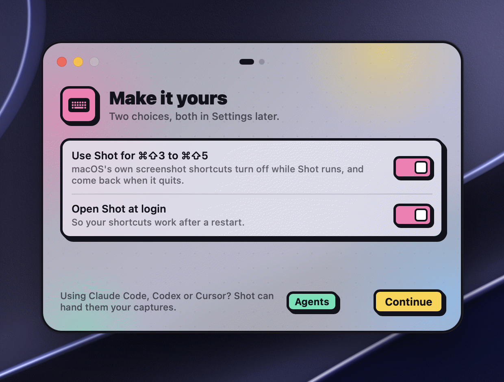

## Install Shot

Shot needs macOS 15 or later.

**With [Homebrew](https://brew.sh):**

```sh
brew install lorcanchinnock/tap/shot
```

**Or by hand:** download the zip from the [latest release](https://github.com/LorcanChinnock/shot/releases/latest), unzip it, and move **Shot.app** to Applications.

## Open it for the first time

Apple hasn't notarized Shot yet, so macOS asks you to confirm it once.

1. Open Shot from Applications. macOS says it can't verify Shot. Click **Done**.
2. Open **System Settings › Privacy & Security**, scroll down to the message about Shot, and click **Open Anyway**.


## Follow the welcome window



A short welcome window walks you through three steps. You can close it at any point to skip the rest.

1. **Allow screen recording.** macOS needs this for every capture. Click **Grant** and turn Shot on under **Screen & System Audio Recording**, then click **Relaunch**. macOS only applies the permission after Shot restarts. If Shot already has it, you won't see this step.
2. **Make it yours.** Choose whether Shot takes over the screenshot keys <kbd>⌘⇧3</kbd> to <kbd>⌘⇧5</kbd>, and whether it opens when you log in. Both start on. Click **Continue** to apply them. If you close the window here instead, macOS keeps its keys and Shot doesn't open at login.
3. **Try it.** Press <kbd>⌘⇧4</kbd> and drag across anything on screen. The window comes back with a few tips.

> [!TIP]
> Turned off **Use Shot for ⌘⇧3 to ⌘⇧5**? Shot uses <kbd>⌃⇧3</kbd>, <kbd>⌃⇧4</kbd> and <kbd>⌃⇧5</kbd> instead, and the macOS screenshot tool keeps its keys. Either way, macOS gets its keys back whenever Shot quits.

## Where to find Shot

Shot lives in the menu bar, not the Dock. Click its icon for every capture and recording action, your [gallery](#find-your-captures) and **Settings**. This guide is linked from **Settings › About**.

After each capture, Shot saves it, copies it, and shows a small [Quick Access](#quick-access) card in the corner of the screen. Paste it anywhere straight away, or hover the card to annotate it.

## Three shortcuts to remember

| Press | To |
|---|---|
| <kbd>⌘⇧4</kbd> | Capture an area. Press <kbd>Space</kbd> to pick a window instead. |
| <kbd>⌘⇧3</kbd> | Capture the whole screen. |
| <kbd>⌘⇧5</kbd> | Record your screen. |

Every other shortcut is on the [Keyboard shortcuts](#keyboard-shortcuts) page.

## Next steps

- [Take a screenshot](#take-a-screenshot): areas, windows, a timer, and copying text off the screen.
- [Record your screen](#record-your-screen), with your voice and camera if you like.
- [Annotate a screenshot](#annotate-a-screenshot) with arrows, text and blur.
- [Share a capture with an AI assistant](#share-a-capture-with-an-ai-assistant) such as Claude or ChatGPT.

> [!NOTE]
> To see the welcome window again, open [`shot://welcome`](#url-scheme). It starts from your current settings, and closing it changes nothing. If Shot ever loses its screen recording permission, your next capture opens the window at that step.
