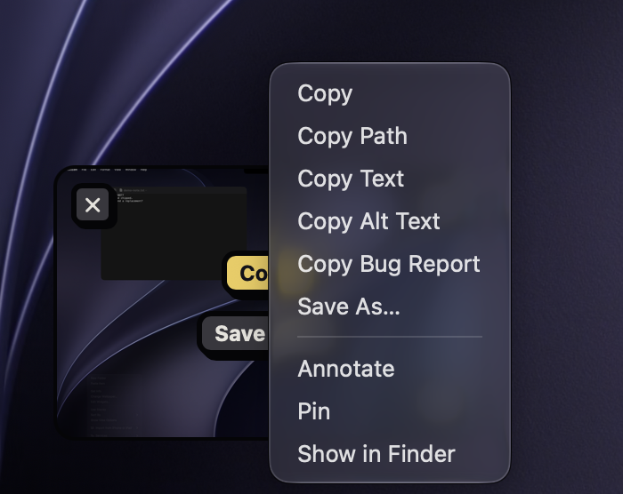
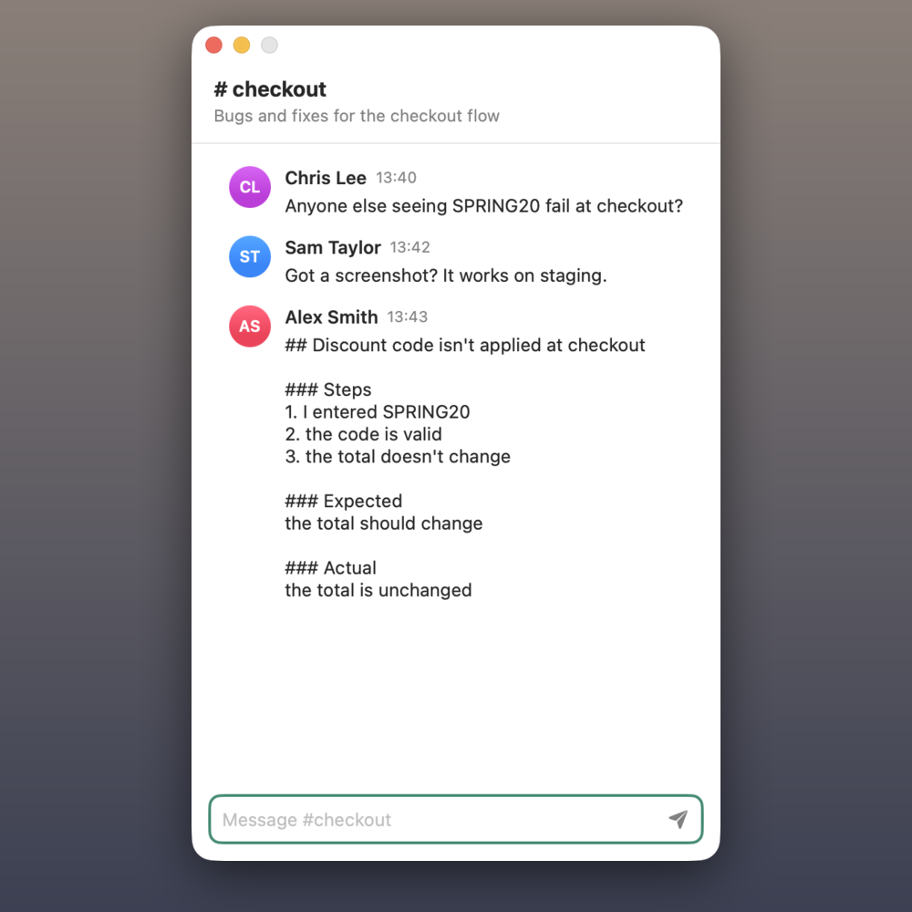

Every screenshot is saved, copied to the clipboard as a PNG, and shown in a [Quick Access](#quick-access) card, so you can paste it straight away.

## Capture an area

1. Press <kbd>⌘⇧4</kbd>. The screen freezes.
2. Drag across what you want. A magnifier by the pointer helps you line up exact edges, and a label shows the size in pixels.
3. Let go.

While you drag:

| Press | To |
|---|---|
| <kbd>Shift</kbd> | Keep the area square. |
| <kbd>Tab</kbd> | Step through 1:1, 4:3, 3:2 and 16:9, then back to free. <kbd>⇧Tab</kbd> steps back. The way you start dragging picks landscape or portrait. |
| <kbd>X</kbd> | Turn the ratio between landscape and portrait. |
| <kbd>Space</kbd> | Hold it to move the whole area. |
| <kbd>Esc</kbd> | Cancel. |

## Capture a window

1. Press <kbd>⌘⇧4</kbd>, then <kbd>Space</kbd>.
2. Click the window.

Shot captures the window as it is right now, even if something covers it, and keeps its macOS shadow. To leave the shadow out, turn off **Window shadow** in **Settings › Capture**.

## Capture the whole screen

Press <kbd>⌘⇧3</kbd>. Shot captures the screen the pointer is on.

## Use a timer

Need to open a menu or hover over something first? Choose **Capture Full Screen After Delay** in Shot's menu bar menu. Shot counts down on screen for 3 or 5 seconds, the same as your recording countdown, then captures the screen under the pointer. Shot's menu bar icon shows the seconds left too.

Shot stays in the background while it counts, so the menu you open stays open. Press <kbd>Esc</kbd> or click **Cancel** to stop.

## Capture the same area again

**Capture Previous Area** in the menu bar menu takes the same area as your last area screenshot, with no dragging. It's handy for a before-and-after pair that lines up exactly.

> [!TIP]
> It has no shortcut until you give it one in **Settings › Shortcuts**. Shot forgets the area when it quits.

## Copy text from the screen

Copy Text reads the text in part of the screen and copies it, without saving a screenshot. Everything happens on your Mac.

1. Give **Copy Text** a shortcut in **Settings › Shortcuts**, then press it.
2. Drag across the text, or press <kbd>Space</kbd> and click a window.
3. Paste the text wherever you like.

To copy the text from a screenshot you already took, right-click its Quick Access card or its tile in the [gallery](#find-your-captures) and choose **Copy Text**.

## Translate the text in a screenshot

On macOS 26 or later, Shot can copy the text in a screenshot translated into another language. It uses Apple's translation on your Mac, so nothing is uploaded.

1. Right-click the screenshot's Quick Access card and choose **Translate Text**, or in the editor choose **Edit › Translate Text**.
2. Choose a language. The one you used last is at the top, and the first time it's your Mac's language.
3. Paste the translation wherever you like. Each paragraph is on its own line.

The first time you translate between two languages, macOS asks to download them. Click **Download** beside each one, then **Done**. In the editor, the translation includes text you've added on top of the screenshot.

## Copy alt text for a screenshot

Alt text describes an image for people who use a screen reader. On macOS 27 or later, with Apple Intelligence turned on, Shot can write it for you with Apple's model on your Mac. Nothing is uploaded, and it never runs unless you ask.

1. Right-click the screenshot's Quick Access card or its tile in the gallery and choose **Copy Alt Text**, or in the editor choose **Edit › Copy Alt Text**.
2. Paste the description where the image's alt text goes, such as a document, a post or an email.

You get one or two plain sentences, usually within a couple of seconds. Read the text before you use it: the model can miss small details or misread tiny text.

## Copy a bug report

Copy Bug Report turns a screenshot or a recording into repro steps you can paste into a ticket or a message. It uses the same model as alt text: Apple's on your Mac on macOS 27 or later, or the AI provider you set up. It never runs unless you ask.

1. Right-click the capture's Quick Access card or its tile in the gallery and choose **Copy Bug Report**, or in the image editor or video editor choose **Edit › Copy Bug Report**. The video editor writes it from the recording as it was made, before any trims or cuts.
2. Wait for the **Writing bug report…** note at the bottom of the screen to say **Copied bug report**. On your Mac's own model this can take up to a minute. Then paste the result. It has a title, **Steps**, **Expected**, **Actual** and, if the capture shows one, the **Error text**.

For a recording, Shot picks a few frames where the picture changes, reads the text on them, and includes what you said if the recording has your voice (macOS 26 or later). Apple's model takes only a few frames, so a long recording is summarised from part of it, and the report says so.

Error text is copied from what your Mac read in the capture, never from the model's guess, so it matches the screen word for word. The steps and the expected result are the model's reading: check them before you send. If a recording shows nothing going wrong, the **Actual** says "No problem shown". Smaller models sometimes add a step nobody did.

## Without a mouse

After <kbd>⌘⇧4</kbd>, press an arrow key to start an area at the pointer, or in the middle of the screen. Then:

- Arrow keys move the area by 10 points, or by 1 with <kbd>Shift</kbd>.
- <kbd>⌥</kbd> with the arrow keys resizes it.
- <kbd>Tab</kbd> still sets the ratio, and <kbd>Return</kbd> captures.

To pick a window, press <kbd>Space</kbd>, step through the windows with <kbd>Tab</kbd> and <kbd>⇧Tab</kbd>, and press <kbd>Return</kbd>. VoiceOver reads out the size and the window's name as you go.

## Choose what happens after a capture

In **Settings › Capture**, choose whether Shot saves each screenshot, copies it and shows Quick Access, or opens it in the [annotation editor](#annotate-a-screenshot) straight away.

> [!NOTE]
> Every action here also has a [`shot://` link](#url-scheme), such as `shot://capture-timer?seconds=5`, `shot://capture-previous` and `shot://copy-text`, for scripts and launchers.
