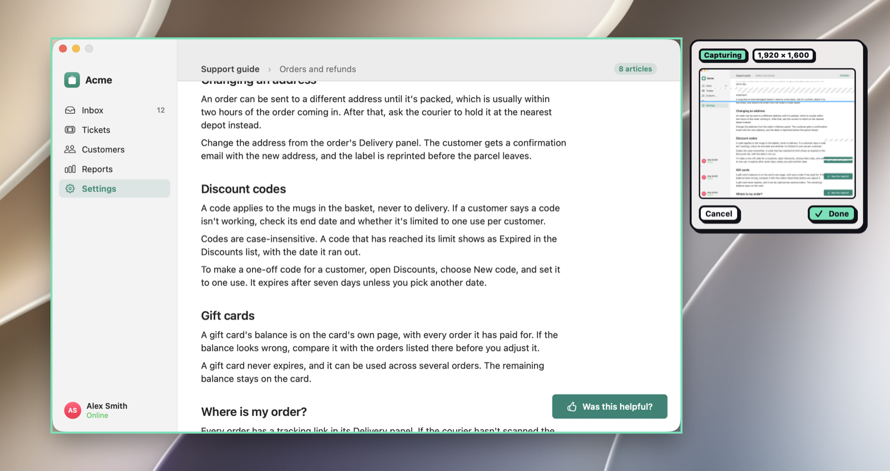

Every screenshot is saved, copied to the clipboard as a PNG, and shown in a [Quick Access](#quick-access) card, so you can paste it straight away.

## Take a screenshot

1. Press <kbd>⌘⇧4</kbd>, or choose **Screenshot** in the menu bar menu. The screen freezes.
2. Drag across what you want. A magnifier by the pointer helps you line up exact edges, and a label shows the size in pixels.
3. Let go.

Chips at the top of the screen show what you are about to capture: **Area**, **Window**, **Browser** or **Full Screen**. Press <kbd>Tab</kbd> to move to the next one (<kbd>⇧Tab</kbd> goes back), or click a chip. Shot remembers the one you used last, for screenshots and recordings separately, and opens on it next time.

- **Area:** drag across it.
- **Window:** click a window. Shot captures it as it is right now, even if something covers it, and keeps its macOS shadow. To leave the shadow out, turn off **Window shadow** in **Settings › Capture**.
- **Browser:** click a browser window to capture just the web page, without the tabs and address bar. Browser needs Accessibility access to find where the page is. If you haven't allowed it, choosing Browser shows a card with a **Grant Accessibility** button, and you can also grant it in the welcome window or **Settings › About**. It works with Safari, Chrome and Edge, and for recordings too. A recording of a window or page follows it when you move or resize it, and keeps the video at the size it started at, with empty bars if the shape changes.
- **Full Screen:** click the screen you want, or press <kbd>Return</kbd>. With more than one display, the one under the pointer is highlighted.

While you drag an area:

| Press | To |
|---|---|
| <kbd>Shift</kbd> | Keep the area square. |
| <kbd>R</kbd> | Step through 1:1, 4:3, 3:2 and 16:9, then back to free. <kbd>⇧R</kbd> steps back. The way you start dragging picks landscape or portrait. |
| <kbd>X</kbd> | Turn the ratio between landscape and portrait. |
| <kbd>Space</kbd> | Hold it to move the whole area. |
| <kbd>Esc</kbd> | Cancel. |

## Wait before the screenshot

Need to open a menu or hover over something first? Click the **Delay** chip, or press <kbd>D</kbd>, to step through Off, 3, 5 and 10 seconds. Then pick the area, window, browser page or screen as usual. Shot counts down on screen and captures what is there when the time is up. Shot's menu bar icon shows the seconds left too.

Shot stays in the background while it counts, so the menu you open stays open. Press <kbd>Esc</kbd> or click **Cancel** to stop. The delay is back to Off the next time you take a screenshot.

## Capture a long page

Scroll takes one screenshot of something taller or wider than the screen: a long web page, a chat thread, a document, a settings list or a spreadsheet. You scroll, and Shot builds the picture as you go. Shot never scrolls for you, so it works in every app and needs no extra permissions.

1. Press the screenshot shortcut, then click the **Scroll** chip or press <kbd>S</kbd>. It starts off each time.
2. Pick what scrolls: drag across it, or choose Window or Browser and click it. A panel appears beside it.
3. Scroll the content with the trackpad, the mouse wheel, <kbd>Page Down</kbd> or <kbd>Space</kbd>. Any direction works, and so does scrolling back. The panel's preview shows the picture so far, with the parts you haven't scrolled over hatched, so you can go back and fill them in.
4. Press <kbd>Return</kbd> or click **Done**. The screenshot is copied and saved like any other. <kbd>Esc</kbd> cancels and keeps nothing.

Sticky headers, footers, pinned columns and floating buttons appear once, where they belong. The picture can be up to 30,000 pixels on a side.

### What you can scroll

- **A window:** choose Window, click the window, then scroll it. This suits a chat thread or a settings list.
- **A browser page:** choose Browser, click the page, then scroll it. Shot scrolls along the page you clicked.
- **A screen:** choose Screen to scroll everything you see, such as a spreadsheet that fills the display.
- **An area:** drag across the part that scrolls, which keeps a sidebar or a toolbar out of the picture.

### When the panel asks for something

The panel's outline turns red and it says what to do:

| Message | What to do |
| --- | --- |
| Scrolled too far at once. Scroll back a little and carry on. | You jumped further than the area is tall, so Shot can't tell how the two parts join. Scroll back until you see something you saw before, then continue more slowly. |
| Something in the area keeps changing, so Shot can't line frames up. | A video, an animation or a live counter is moving. Pause the video, or scroll past it. |
| There isn't enough in the area to line frames up. | The area is a blank page or a single flat colour. Include some text or an image, or drag out another area. |
| The image is as big as Shot can stitch. | You reached the size limit. Press <kbd>Return</kbd> to save it. |

## Without a mouse

After <kbd>⌘⇧4</kbd>, press an arrow key to start an area at the pointer, or in the middle of the screen. Then:

- Arrow keys move the area by 10 points, or by 1 with <kbd>Shift</kbd>.
- <kbd>⌥</kbd> with the arrow keys resizes it.
- <kbd>R</kbd> sets the ratio, and <kbd>Return</kbd> captures.

To pick a window, press <kbd>Tab</kbd>, step through the windows with the arrow keys, and press <kbd>Return</kbd>. VoiceOver reads out the size and the window's name as you go.

## Choose what happens after a capture

In **Settings › Capture**, choose whether Shot saves each screenshot, copies it and shows Quick Access, or opens it in the [annotation editor](#annotate-a-screenshot) straight away.

> [!NOTE]
> Every action here also has a [`shot://` link](#url-scheme), such as `shot://capture-window`, for scripts and launchers.
