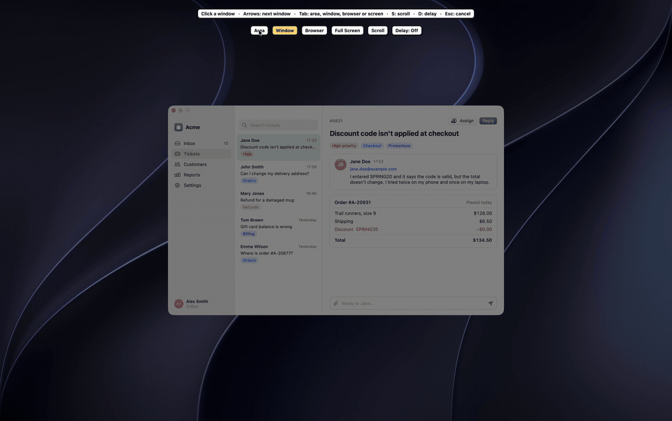

Every screenshot is saved, copied to the clipboard as a PNG, and shown in a [Quick Access](#quick-access) card, so you can paste it straight away.

## Take a screenshot

1. Press <kbd>⌘⇧4</kbd>, or choose **Screenshot** in the menu bar menu. The screen freezes.
2. Drag across what you want. For exact edges, turn on the magnifier, the crosshair and a label with the size in pixels in **Settings › Capture**.
3. Let go.

A small bar at the bottom of the screen starts with **Screenshot** or **Record**, then shows what you are about to capture, picked in yellow: **Area**, **Window**, **Full Screen** or **Browser**. Press <kbd>Tab</kbd> to move between Area, Window and Full Screen (<kbd>⇧Tab</kbd> goes back), or click an icon. Point at an icon to see its name and key. Shot remembers the one you used last, for screenshots and recordings separately, and opens on it next time.

The bar never appears in your screenshot, and it stays out of the way: it fades away about 4 seconds after it shows (it stays while the pointer is on it), so you can pick the area under it, and any of its keys brings it back. It also hides while you drag out an area, and moves to the top of the screen when the window you point at is under it. To start an area right under the bar, just drag from it: a click picks an icon, a drag starts the area.

The last three icons switch the magnifier (<kbd>M</kbd>), the crosshair (<kbd>C</kbd>) and the size readout (<kbd>I</kbd>) for this capture, whatever **Settings › Capture** says. They only change what you see when you pick an area. The size readout sits above the area's top-left corner and gives its size in pixels, next to its ratio. The magnifier follows the pointer, showing each pixel around it with the pointer's position in pixels underneath. When you pick a ratio with <kbd>R</kbd>, it shows above the area even with the size readout off.

- **Area:** drag across it.
- **Window:** click a window. The window under the pointer turns yellow, with its name and size in pixels in the middle. Shot captures it as it is right now, even if something covers it, and keeps its macOS shadow. To leave the shadow out, turn off **Window shadow** in **Settings › Capture**.
  To capture just the web page of a browser window, without the tabs and address bar, turn on **Capture only the page in browser windows** in **Settings › Capture**. Shot then captures the page when you click Safari, Chrome or Edge, and the whole window for any other app. It needs Accessibility access to find where the page is, which Shot asks for when you turn the setting on. If you click **Browser** before allowing it, a card says why Shot needs it: click **Grant Access** to see the macOS prompt, or **Use Window** to capture the whole window this time. To switch it for one capture, click **Browser** (the globe) or **Window** on the bar, or press <kbd>B</kbd>. It works for recordings too. A recording of a window or page follows it when you move or resize it, and keeps the video at the size it started at, with empty bars if the shape changes.
- **Full Screen:** click the screen you want, or press <kbd>Return</kbd>. With more than one display, the one under the pointer is highlighted in yellow, with its name and size.

While you drag an area:

| Press | To |
|---|---|
| <kbd>Shift</kbd> | Keep the area square. |
| <kbd>R</kbd> | Step through 1:1, 4:3, 3:2 and 16:9, then back to free. <kbd>⇧R</kbd> steps back. The way you start dragging picks landscape or portrait. |
| <kbd>X</kbd> | Turn the ratio between landscape and portrait. |
| <kbd>Space</kbd> | Hold it to move the whole area. |
| <kbd>Esc</kbd> | Cancel. |

## Wait before the screenshot

Need to open a menu or hover over something first? Click **Delay** (the timer) on the bar, or press <kbd>D</kbd>, to step through Off, 3, 5 and 10 seconds. Then pick the area, window or screen as usual. Shot counts down on screen and captures what is there when the time is up. Shot's menu bar icon shows the seconds left too.

Shot stays in the background while it counts, so the menu you open stays open. Press <kbd>Esc</kbd> or click **Cancel** to stop. The delay is back to Off the next time you take a screenshot.

## Capture a long page

Scroll takes one screenshot of something taller or wider than the screen: a long web page, a chat thread, a document, a settings list or a spreadsheet. You scroll, and Shot builds the picture as you go. Shot never scrolls for you, so it works in every app and needs no extra permissions.

1. Press the screenshot shortcut, then click **Scroll** (the arrow to a line) on the bar, or press <kbd>S</kbd>. It starts off each time.
2. Pick what scrolls: drag across it, or choose Window and click it. A panel appears beside it.
3. Scroll the content with the trackpad, the mouse wheel, <kbd>Page Down</kbd> or <kbd>Space</kbd>. Any direction works, and so does scrolling back. The panel's preview shows the picture so far, with the parts you haven't scrolled over hatched and a yellow line where you are now, so you can go back and fill them in. Beside it are the picture's size, how many frames it's built from, and whether a sticky header was found. If Shot can't line up what you scrolled, a yellow card under them says what to do.
4. Press <kbd>Return</kbd> or click **Done**. The screenshot is copied and saved like any other. <kbd>Esc</kbd> cancels and keeps nothing.

Sticky headers, footers, pinned columns and floating buttons appear once, where they belong. When you press Return, Shot builds the saved picture again from every frame it kept, so the saved image can be sharper and cleaner than the live preview. The picture can be up to 30,000 pixels on a side.

Some ways to use it:

- **A window.** Choose Window, click a chat thread or a settings window, and scroll to the top of the conversation. The pinned header and message box appear once.
- **A browser page.** Choose Window, click the browser (with **Capture only the page in browser windows** on, to leave out the tabs), and scroll to the footer. A header that stays in view as you scroll appears once, at the top.
- **A screen.** Drag across the whole screen to join a spreadsheet's rows and columns into one picture. Scroll down, sideways or both.

If the panel says something needs attention, it tells you what to do:

- **Scrolled too far.** The content moved so far in one go that nothing in the new view matches the last one. Scroll back a little and carry on.
- **Can't line up.** Something in the area keeps changing, such as a video. Pause it or scroll past it.
- **Nothing to line up.** The area is blank or repeats. Include some text or an image.

## Without a mouse

After <kbd>⌘⇧4</kbd>, press an arrow key to start an area at the pointer, or in the middle of the screen. Then:

- Arrow keys move the area by 10 points, or by 1 with <kbd>Shift</kbd>.
- <kbd>⌥</kbd> with the arrow keys resizes it.
- <kbd>R</kbd> sets the ratio, and <kbd>Return</kbd> captures.

To pick a window, press <kbd>Tab</kbd>, step through the windows with the arrow keys, and press <kbd>Return</kbd>. VoiceOver reads out the size and the window's name as you go.

## Choose what happens after a capture

In **Settings › Capture**, choose whether Shot saves each screenshot, copies it and shows Quick Access, or opens it in the [annotation editor](#annotate-a-screenshot) straight away.

> [!NOTE]
> Every action here also has a [`shot://` link](#url-scheme), such as `shot://capture-window`, for scripts and launchers.
