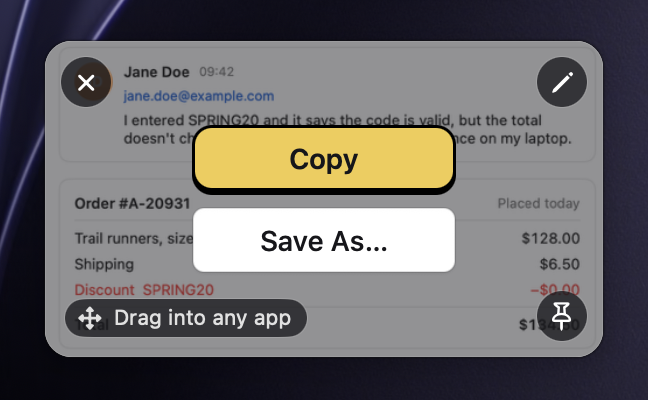
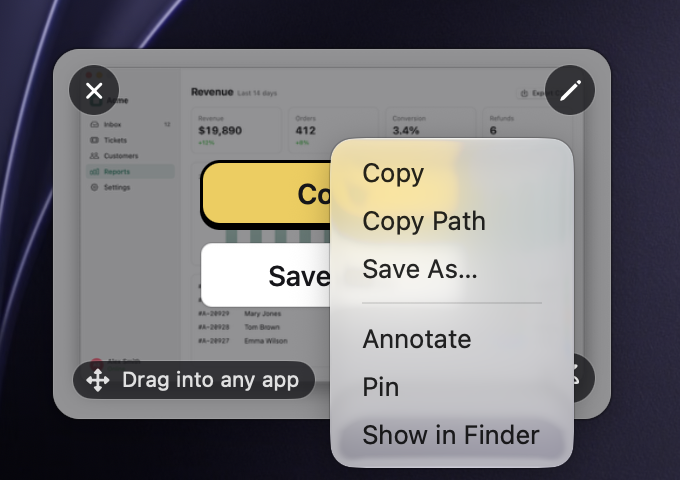

After every screenshot or recording, a small card slides into a bottom corner of the screen you're on. Your capture is already saved and copied, so you can ignore the card and paste. When you want more, it's right there.

## Use the card

The card is just your capture until you point at it. Hover it to dim the picture and show its buttons: **Copy** and **Save As…** in the middle, **Close** in the top-left corner, **Annotate** in the top right and **Pin to Screen** in the bottom right. A recording has **Edit Video** and **Export GIF** in the top right instead, and no pin.

| Button | What it does |
|---|---|
| **Copy** | Copies the capture again. |
| **Save As…** | Saves a copy somewhere else. |
| **Annotate** | Opens a screenshot in the [annotation editor](#annotate-a-screenshot). For a recording, this is **Edit Video**, which opens the [video editor](#edit-a-recording). |
| **Export GIF** | Turns a recording into a GIF, at the frame rate and width you last chose in the video editor. It keeps the first 60 seconds. |
| **Pin to Screen** | Floats a screenshot above your other windows (see [Pin a screenshot](#pin-a-screenshot)). |
| **Close** | Closes the card. |

A recording's card shows its length in the bottom-right corner, even when you're not pointing at it.

Drag the card straight into another app to drop the file there, as the **Drag into any app** label in its bottom-left corner says, or onto an open editor to [combine images](#combine-images).

Right-click the card for the same actions, plus **Copy Path** and **Show in Finder**.

## Pin a screenshot

**Pin** floats a screenshot above your other windows, so you can keep it in view while you work.

1. Hover the card and click the pin button in its bottom-right corner, or right-click the card and choose **Pin**.
2. Drag the pin to move it, or drag its edges to resize it.
3. To close it, hover it and click **✕** at the left of its bar, or click it and press <kbd>Esc</kbd>.

A pin opens in the middle of the screen at its own size, or at half the screen if it's bigger, and the card closes. If the screenshot has a style, the pin shows it the way **Copy** would, shadow and border included. A window captured with its shadow keeps its see-through edge too. You can have several pins open at once.

When you hover a pin, a dark bar appears across its top, with **Pinned** and its opacity, such as 100%, beside the close button:

- Drag the slider to let the windows behind show through the pin, down to 20%. Once you've clicked the pin, <kbd>↑</kbd> and <kbd>↓</kbd> change it in steps of 10%.
- Click the pointer button at the right to turn on **Click Through**. Clicks then go to the window under the pin, so you can work in it with the pin still on top. The bar keeps working, so click the same button again to turn it off.

## Choose where cards go and how long they stay

The newest card sits in front, with older ones waiting behind it as a dark edge along its top, up to five. A sixth closes the oldest. Point at the stack to spread the cards out above the front one and reach an older one. The front card stays where it was, so **Copy** never moves under the pointer. Each card closes on its own after 8 seconds, but none closes while the pointer is on the stack.

In **Settings › Quick Access**, set **Screen corner** to **Bottom left** or **Bottom right**, and **Auto-close** to how long cards stay: 4, 8, 15 or 30 seconds, or **Never**. The preview under those options shows a card in the corner you chose and counts down the time you picked. To skip the card altogether, turn off **Show Quick Access** in **Settings › Capture**.

## Messages after you copy or save

When you copy or save from a card, a small dark message such as **Copied** or **Saved Shot 2026-11-07 at 10.42.15.png** confirms it, with a yellow tick. It sits in the same corner as the cards, just above them while they're showing, and a click dismisses it. The same message shows how far a GIF export has got, with **Cancel**, and offers **Undo** after you discard a recording.
