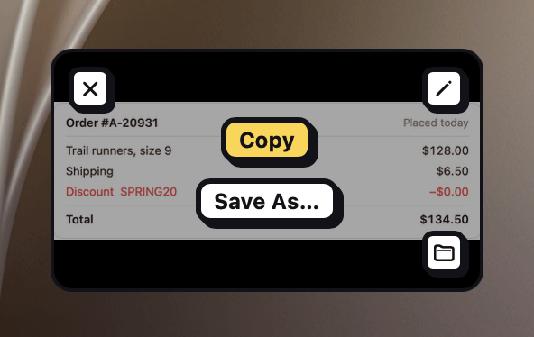

After every screenshot or recording, a small card slides into a bottom corner of the screen you're on. Your capture is already saved and copied, so you can ignore the card and paste. When you want more, it's right there.

## Use the card

Hover the card to show its buttons:

| Button | What it does |
|---|---|
| **Copy** | Copies the capture again. |
| **Save As…** | Saves a copy somewhere else. |
| **Annotate** | Opens a screenshot in the [annotation editor](#annotate-a-screenshot). For a recording, this is **Edit**, which opens the [video editor](#edit-a-recording). |
| **Export GIF** | Turns a recording into a GIF, at the frame rate and width you last chose in the video editor. It keeps the first 60 seconds. |
| **Show in Finder** | Shows the file in its folder. |
| **Close** | Closes the card. |

Drag the card straight into another app to drop the file there, or onto an open editor to [combine images](#combine-images).

Right-click the card for the same actions, plus **Copy Path**, and for a screenshot, **Copy Text**, **Translate Text** (macOS 26 or later), **Copy Alt Text** and **Copy Bug Report** (macOS 27 or later, or any macOS with your own AI provider; **Copy Bug Report** also works on a recording) and **Pin**.

## Pin a screenshot

**Pin** floats a screenshot above your other windows, so you can keep it in view while you work.

1. Right-click the card and choose **Pin**.
2. Drag the pin to move it, or drag its edges to resize it.
3. To close it, hover it and click its close button, or click it and press <kbd>Esc</kbd>.

A pin opens in the middle of the screen at its own size, or at half the screen if it's bigger, and the card closes. If the screenshot has a style, the pin shows it the way **Copy** would, shadow and border included. You can have several pins open at once.

## Use it from the keyboard

1. Give **Focus Quick Access** a shortcut in **Settings › Shortcuts**, then press it.
2. The newest card gets a yellow ring and shows its buttons. The app you were using stays in front, and the cards stop closing on their own.

Then:

| Press | To |
|---|---|
| <kbd>↑</kbd> <kbd>↓</kbd> | Move between cards. |
| <kbd>Return</kbd> or <kbd>⌘C</kbd> | Copy the card and hand the keyboard back to your app, ready to paste. |
| <kbd>Space</kbd> | Open the card's menu, the same as right-clicking. |
| <kbd>⌘S</kbd> | **Save As…** |
| <kbd>⌘E</kbd> | **Annotate**, or **Edit** for a recording. |
| <kbd>Delete</kbd> | Close the card. |
| <kbd>Esc</kbd> | Hand the keyboard back. Clicking somewhere else does the same, and the cards' timers start again. |

## Choose where cards go and how long they stay

New cards stack above older ones, up to five. A sixth closes the oldest. Each card closes on its own after 8 seconds, and hovering it pauses the timer.

In **Settings › Quick Access**, choose the bottom-left or bottom-right corner, and how long cards stay: 4, 8, 15 or 30 seconds, or **Never**. To skip the card altogether, turn off **Show Quick Access** in **Settings › Capture**.

> [!NOTE]
> **Focus Quick Access** also has a [`shot://` link](#url-scheme): `shot://focus-quick-access`.
