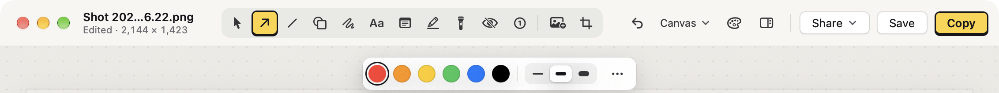
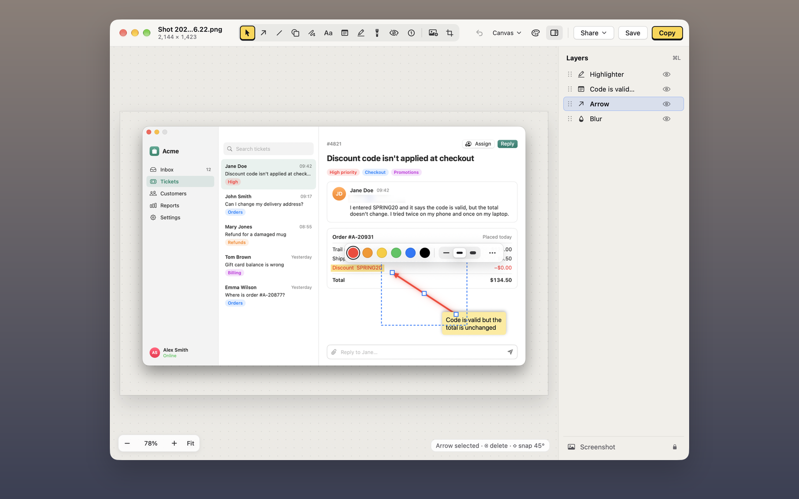

## Open the editor

Any of these opens a screenshot in the annotation editor:

- **Annotate** on its [Quick Access](#quick-access) card.
- **Annotate** in the [gallery](#find-your-captures), or a double-click on the screenshot there.
- **Open in editor** in **Settings › Capture**, which opens every new screenshot in the editor straight away.
- A [`shot://annotate?path=…`](#url-scheme) link.

## Pick a tool

Press a tool's key, or click it in the group of tools in the middle of the title bar. Hover a tool to see its name, its key and what it does.

| Key | Tool |
|---|---|
| <kbd>V</kbd> | **Select:** move, resize and restyle what you've drawn. |
| <kbd>H</kbd> | **Hand:** drag to move around when zoomed in, without touching your marks. It has no button, so press <kbd>H</kbd> or hold <kbd>Space</kbd>. |
| <kbd>A</kbd> | **Arrow** |
| <kbd>L</kbd> | **Line** |
| <kbd>R</kbd> | **Shape:** rectangle, ellipse, triangle, diamond or star. |
| <kbd>D</kbd> | **Pen:** draw freehand. |
| <kbd>T</kbd> | **Text:** click and type, or drag out a box for text that wraps. |
| <kbd>S</kbd> | **Sticky note** |
| <kbd>M</kbd> | **Highlight:** a freehand marker. |
| <kbd>F</kbd> | **Spotlight:** dims or blurs everything outside an area. |
| <kbd>B</kbd> | **Redact:** blurs or pixelates an area. |
| <kbd>N</kbd> | **Counter:** numbered circles, for steps. |
| <kbd>C</kbd> | **Crop:** see [Crop and arrange](#crop-and-arrange). |

After a divider, beside **Crop**, **Add an image** (<kbd>⇧⌘I</kbd>) places another picture beside your screenshot. See [Combine images](#combine-images).

The keys work whenever you aren't typing text. The editor remembers the last drawing tool, so a new window starts with it, or with the arrow.

## Draw

Drag on the screenshot to draw with the tool you picked. While you drag:

- <kbd>Shift</kbd> keeps a box square, and an arrow, line or highlight at 45° steps.
- <kbd>⌥</kbd> draws from the centre.
- <kbd>Esc</kbd> cancels what you're drawing.

Your marks can reach past the edges of the screenshot. The canvas grows to fit them.

With the text tool, click and start typing for a label as wide as its words, in the text size the style bar shows. To fit text into a column, drag out a box instead: its height is one line of text, so a short box gives small text and a tall one large text. The text wraps to the box's width, and the box grows taller as you type. <kbd>Return</kbd> finishes the text, and <kbd>Shift</kbd>-<kbd>Return</kbd> starts a new line in a box.

The hint at the bottom right of the canvas tells you what the tool does, or what you've selected, with the keys that change it. With an arrow selected it reads "Arrow selected · ⌫ delete · ⇧ snap 45°". It shows for a few seconds each time you pick a tool or select something, then fades so it doesn't cover the screenshot. It and the zoom control also fade while you drag. With VoiceOver on, the hint stays and is read out when it changes.

## Choose colours and options

A small style bar floats over the screenshot with the options for the tool you picked. It sits at the top of the screenshot until you draw, then moves next to the mark you selected, above it where there's room, and otherwise below or beside it, so it never covers the mark. It steps out of the way while you drag.

The colours are on the left, a row for each, named on its left. Every row has the same swatches: seven colours, white included, a rainbow swatch that picks any colour, and a grey and white check for transparent, which draws nothing. The rainbow swatch's eyedropper takes a colour from anywhere on screen, such as a brand colour in the screenshot itself.

- **Arrows, lines, pens and highlights:** a **Line** row, and the width.
- **Shape:** **Line** for the outline, and **Fill** under it for the inside. Transparent leaves a shape unfilled. On the right are the width and the five outlines: a rectangle, ellipse, triangle, diamond or star. Picking one with a shape selected changes that shape, and <kbd>⌘Z</kbd> changes it back.
- **Text:** a **Text** row, the text size, and left, centre or right alignment.
- **Sticky note:** **Text**, and **Background** under it for the paper. Until you pick a text colour, the text is black or white, whichever reads better on the paper, and no swatch shows as chosen. Click the chosen colour again to go back to that. On the right are the text size, the alignment, and whether the text sits at the top, middle or bottom, which shows when you drag the note taller than its text. New notes centre their text both ways.
- **Counter:** a **Fill** row for the circle behind the number, and its size.
- **Redact:** blur or pixelate, and how strong it is.
- **Spotlight:** a rectangle or an ellipse, whether to darken or blur outside it, how strongly, and how soft its edge is. Every spotlight in the screenshot shares one dim, so the effect and strength apply to all of them.

The width and text size work like the font size box in a word processor. The down and up arrows step through the usual sizes, and the arrows between them list those sizes to pick from. You can also click the number, type any size and press <kbd>Return</kbd>. It's kept within the smallest and largest sizes, and <kbd>Esc</kbd> puts the old one back. Changing the size or colour while you type updates the text as you go.

The bar doesn't show while you crop, since the crop has a bar of its own, or when the select tool has nothing, an image or several marks selected. Use **Style** in the title bar for those.

Each palette remembers the last colour you picked. The highlight and sticky notes keep their own colours, yellow at first, so they don't take the colour of your arrows. The editor remembers the options you last used.

To go back to the plain look, choose **Edit › Reset Style**, or right-click the style bar and choose **Reset Style**. It puts that tool's colour, width and other options back to how Shot starts, for the selected mark too, and for the next one you draw, as one undo step. Your saved custom colours stay, and it's greyed out when the options are already the defaults. For a spotlight, **Reset Style** also sets the effect and strength of every spotlight in the screenshot, since they share them.

With keyboard navigation turned on in System Settings, <kbd>Tab</kbd> moves into the style bar, and in the width or text size box, the up and down arrow keys change it.

## Change what you've drawn

What you've just drawn stays selected, so you can fix its colour, width or fill from the style bar beside it without switching tools. The change also applies to what you draw next. It shows no outline or handles, so your next stroke starts a new mark however close to it you press. To move, resize or bend a mark, pick the select tool (<kbd>V</kbd>) and click it.

- **Move** it by dragging, or nudge it with the arrow keys, 1 pixel at a time or 10 with <kbd>Shift</kbd>.
- **Resize** it with its handles. A text box has a handle on each side, and its text wraps again to the new width. <kbd>Shift</kbd> keeps a box's proportions, or snaps an arrow or line end to 45°. <kbd>⌥</kbd> resizes from the centre. Hold <kbd>Space</kbd> to move the whole shape mid-drag.
- **Bend** an arrow or line by dragging its middle handle.
- **Round the corners** of a shape with the small round handles inside them, up to a pill on a rectangle.
- **Edit text** in a text box or sticky note by double-clicking it.
- **Delete** it with <kbd>Delete</kbd>. <kbd>Esc</kbd> deselects.
- **Copy, paste and duplicate** it with <kbd>⌘C</kbd>, <kbd>⌘V</kbd> and <kbd>⌘D</kbd>, even into another editor window.

<kbd>⌘Z</kbd> or the Undo button in the title bar undoes, and <kbd>⇧⌘Z</kbd> redoes, wherever you clicked last. While you're typing in a text box, a note or a field in the style bar, <kbd>⌘Z</kbd> first undoes your typing. Once there's none left, the next <kbd>⌘Z</kbd> finishes the typing and undoes your last change, as the Undo button does.

> [!NOTE]
> Text you clicked to place and counters have no handles, and a placed image only has them at its corners. A triangle or diamond rounds each corner, a star only its points, and an ellipse has none. New shapes start with square corners. While you type in a text box or note, <kbd>Return</kbd> or <kbd>Esc</kbd> finishes it, and then <kbd>⌘Z</kbd> removes it again. In a note or a text box you dragged out, <kbd>Shift</kbd>-<kbd>Return</kbd> starts a new line. With the text or note tool, clicking existing text or a note selects it, dragging moves it, and clicking it again or double-clicking edits it, so you don't need to switch tools first.

> [!TIP]
> With VoiceOver, the canvas lists your marks, frontmost first, by their [layer names](#layers), with the full words of a text or note. Press one (VO-Space) to select it.

## Zoom in

Pinch, press <kbd>⌘+</kbd> and <kbd>⌘−</kbd>, or click **−** and **+** in the zoom control at the bottom left of the canvas. **Fit**, or <kbd>⌘0</kbd>, fits the screenshot to the window. Click the percentage for a menu with **Actual Size** (<kbd>⌘1</kbd>). To move around when zoomed in, scroll, hold <kbd>Space</kbd> and drag, drag with the middle mouse button, or use the hand tool (<kbd>H</kbd>).

## Copy or save

- **Copy**, the yellow button at the right end of the title bar, after **Share** and **Save**, copies the annotated image. With nothing or several things selected, <kbd>⌘C</kbd> does the same.
- **Save** (<kbd>⌘S</kbd>) replaces the screenshot with your edited one and copies it. Shot keeps the original, so you can reopen the screenshot and undo your edits, or choose **Edit › Revert to Original**. This applies to screenshots Shot took. A picture from anywhere else saves as a new copy beside it, `name (2).png` (or `.jpg`), then `name (3).png` and so on, and the original never changes. To always save a new copy, turn off **Settings › General › Save edits over the original**.

Under the file name, the title bar shows the size the image saves at, such as "1,040 × 600", with **Edited** before it while you have unsaved changes. Closing the window asks whether to save them.

## Share

The **Share** menu, beside Save, holds what you need less often:

- **Copy Image** copies the annotated image, as Copy does.
- **Copy Path** copies where the file is on your Mac, for an assistant that can open files. See [Share a capture with an AI assistant](#share-a-capture-with-an-ai-assistant).
- **Save As…** writes the annotated image to a file you name, as PNG or JPEG, and leaves the screenshot as it is.
- **Show in Finder** selects the file in Finder.
- **Pin to Screen** floats the annotated image above your other windows, as [Pin](#quick-access) does from Quick Access.

Copy Path and Show in Finder save your changes first, so the file they point at has your marks.

## Reopen a saved version

Open a version you saved, from the gallery, Quick Access or a `shot://annotate` link, and every mark is still live, so you can move, change or delete it. **Save** then replaces it again, or writes the next copy if you turned off saving over the original.

- The original Shot kept is stored on this Mac only, in Shot's own folder, so it never travels with a file you share. A screenshot you saved over and then copy to another Mac, or edit in another app, opens as a plain image there, and its edits can't be undone. **Settings › About › Kept originals** shows how much space they take and lets you delete them.
- This keeps working when you move or rename the original. If the original is gone, or another image has replaced it, the version opens flattened.
- To edit a version as a plain image instead, choose **Edit › Flatten**, or open the original.
- Shot keeps the layers in its own Application Support folder, not in the image, so a version you share never carries hidden layers or the full-size images you placed.
