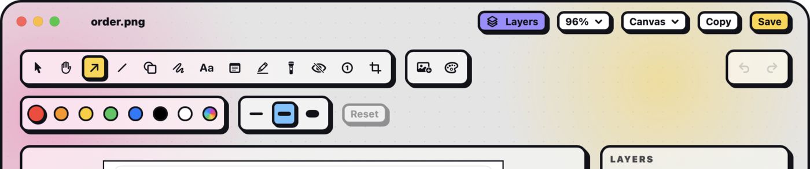
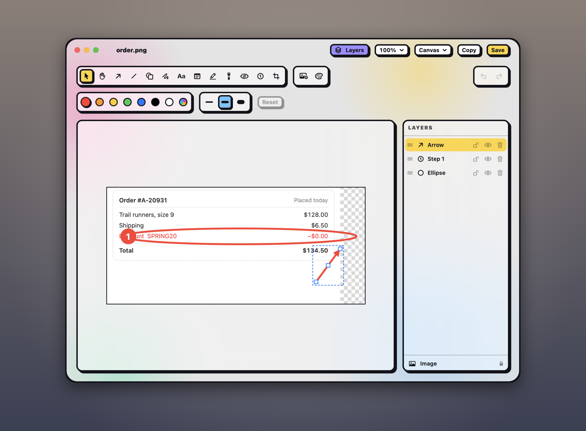

## Open the editor

Any of these opens a screenshot in the annotation editor:

- **Annotate** on its [Quick Access](#quick-access) card.
- **Annotate** in the [gallery](#find-your-captures), or a double-click on the screenshot there.
- **Open in editor** in **Settings › Capture**, which opens every new screenshot in the editor straight away.
- A [`shot://annotate?path=…`](#url-scheme) link.

## Pick a tool

Press a tool's key, or click it in the toolbar. Hover a tool to see what it does.

| Key | Tool |
|---|---|
| <kbd>V</kbd> | **Select:** move, resize and restyle what you've drawn. |
| <kbd>H</kbd> | **Hand:** drag to move around when zoomed in, without touching your marks. |
| <kbd>A</kbd> | **Arrow** |
| <kbd>L</kbd> | **Line** |
| <kbd>R</kbd> | **Shape:** rectangle, ellipse, triangle, diamond or star. |
| <kbd>D</kbd> | **Pen:** draw freehand. |
| <kbd>T</kbd> | **Text** |
| <kbd>S</kbd> | **Sticky note** |
| <kbd>M</kbd> | **Highlight:** a freehand marker. |
| <kbd>F</kbd> | **Spotlight:** dims or blurs everything outside an area. |
| <kbd>B</kbd> | **Redact:** blurs or pixelates an area. |
| <kbd>N</kbd> | **Counter:** numbered circles, for steps. |
| <kbd>C</kbd> | **Crop:** see [Crop and arrange](#crop-and-arrange). |

The keys work whenever you aren't typing text. The editor remembers the last drawing tool, so a new window starts with it, or with the arrow.

## Draw

Drag on the screenshot to draw with the tool you picked. While you drag:

- <kbd>Shift</kbd> keeps a box square, and an arrow, line or highlight at 45° steps.
- <kbd>⌥</kbd> draws from the centre.
- <kbd>Esc</kbd> cancels what you're drawing.

Your marks can reach past the edges of the screenshot. The canvas grows to fit them.

## Choose colours and options

The options for the tool you picked show below the tools:

- **Colour and width:** a colour and one of three widths. For text, sticky notes and counters, the widths are text sizes, and changing the size or colour while you type updates the text as you go.
- **Text and sticky notes:** left, centre or right alignment. A sticky note can also put its text at the top, middle or bottom, which shows when you drag the note taller than its text.
- **Shape:** which shape, and a fill.
- **Redact:** blur or pixelate, and how strong.
- **Spotlight:** a rectangle or an ellipse, a soft edge, whether to darken or blur outside it, and how much. Every spotlight in the screenshot shares one dim, so the effect and strength apply to all of them.

The last swatch picks any colour, and its eyedropper takes a colour from anywhere on screen, such as a brand colour in the screenshot itself. Each palette remembers the last colour you picked. The highlight and sticky notes keep their own colours, yellow at first, so they don't take the colour of your arrows. The editor remembers the options you last used.

To go back to the plain look, click **Reset** at the end of the options. It puts that tool's colour, width and other options back to how Shot starts, for the selected mark too, and for the next one you draw, as one undo step. Your saved custom colours stay, and it's greyed out when the options are already the defaults. For a spotlight, **Reset** also sets the effect and strength of every spotlight in the screenshot, since they share them.

## Change what you've drawn

What you've just drawn stays selected, so you can fix its colour, width or fill from the toolbar, or drag its handles, without switching tools. The change also applies to what you draw next. Otherwise, pick the select tool (<kbd>V</kbd>) and click a mark.

- **Move** it by dragging, or nudge it with the arrow keys, 1 pixel at a time or 10 with <kbd>Shift</kbd>.
- **Resize** it with its handles. <kbd>Shift</kbd> keeps a box's proportions, or snaps an arrow or line end to 45°. <kbd>⌥</kbd> resizes from the centre. Hold <kbd>Space</kbd> to move the whole shape mid-drag.
- **Bend** an arrow or line by dragging its middle handle.
- **Round the corners** of a shape with the small round handles inside them, up to a pill on a rectangle.
- **Edit text** in a text box or sticky note by double-clicking it.
- **Delete** it with <kbd>Delete</kbd>. <kbd>Esc</kbd> deselects.
- **Copy, paste and duplicate** it with <kbd>⌘C</kbd>, <kbd>⌘V</kbd> and <kbd>⌘D</kbd>, even into another editor window.

<kbd>⌘Z</kbd> undoes and <kbd>⇧⌘Z</kbd> redoes.

> [!NOTE]
> Text and counters have no handles, and a placed image only has them at its corners. A triangle or diamond rounds each corner, a star only its points, and an ellipse has none. New shapes start with square corners. While you type in a text box or note, <kbd>Esc</kbd> finishes it, and <kbd>⌘Z</kbd> removes it again. Clicking a note with the note tool also edits it.

> [!TIP]
> With VoiceOver, the canvas lists your marks, frontmost first, by their [layer names](#layers), with the full words of a text or note. Press one (VO-Space) to select it.

## Zoom in

Pinch, or press <kbd>⌘+</kbd> and <kbd>⌘−</kbd>. <kbd>⌘0</kbd> fits the screenshot to the window, and <kbd>⌘1</kbd> shows it at actual size. To move around when zoomed in, scroll, hold <kbd>Space</kbd> and drag, drag with the middle mouse button, or use the hand tool (<kbd>H</kbd>).

## Copy or save

- **Copy** copies the annotated image. With nothing or several things selected, <kbd>⌘C</kbd> does the same.
- **Save** (<kbd>⌘S</kbd>) writes a new version beside the original, `name (2).png` (or `.jpg`), then `name (3).png` and so on, and copies it. The original never changes.

The title bar shows **EDITED** while you have unsaved changes, and closing the window asks whether to save them.

## Reopen a saved version

Open a version you saved, from the gallery, Quick Access or a `shot://annotate` link, and every mark is still live, so you can move, change or delete it. **Save** then writes the next version.

- This keeps working when you move or rename the original. If the original is gone, or another image has replaced it, the version opens flattened.
- To edit a version as a plain image instead, choose **Edit › Flatten**, or open the original.
- Shot keeps the layers in its own Application Support folder, not in the image, so a version you share never carries hidden layers or the full-size images you placed.
- A version saved by an older Shot reopens live only if [**Hand captures to agents**](#hand-captures-to-agents) was on when you saved it, and only if it has no placed images, spotlights, styled marks, aligned text, hidden layers or styled screenshot.

> [!NOTE]
> **When an agent annotates:** an agent's `annotate`, `redact` or `crop`, from the [`shot` command](#the-shot-command-line) or the [MCP server](#the-mcp-server), saves a version the same way. On a version, it draws on the original with the version's layers, so your marks stay live and the agent's go on top. Unlike **Save**, it never copies, shows a Quick Access card or opens the editor; with `-o` it writes the name you give; and the `shot` command also takes an image outside your save folder and writes the version beside it. That version isn't in the gallery, but it still reopens live.
