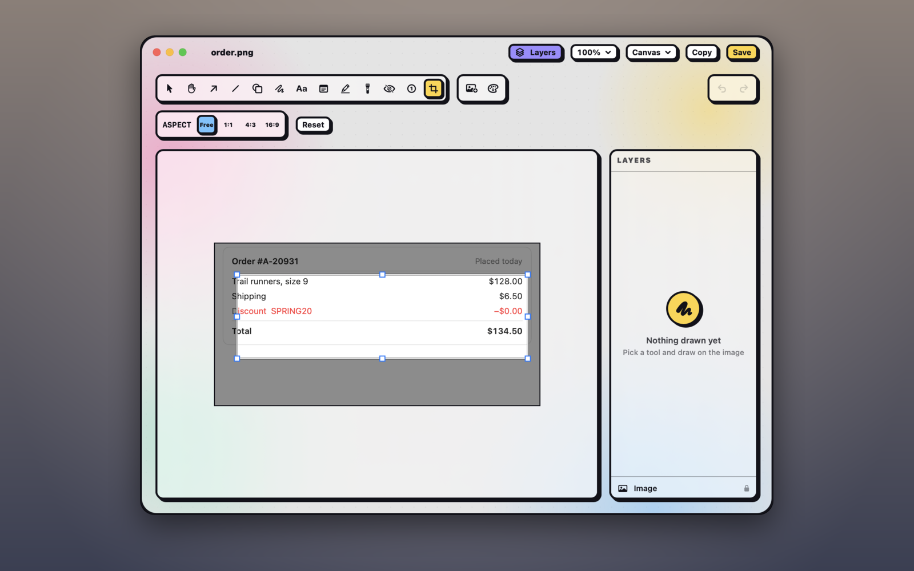

## Crop

1. Press <kbd>C</kbd>, or click the **Frame** row in Layers.
2. Drag the handles to choose what to keep. What's cropped off shows dimmed.
3. Press <kbd>Return</kbd> to apply the crop, or <kbd>Esc</kbd> to cancel.

While you crop:

- **Drag a handle** to resize the crop, in or out. An edge can go as far as the content reaches, padding and your marks included, so dragging outward brings cropped pixels back. Edges snap to the screenshot's edges.
- **Drag inside** the crop to move it, or **outside** it to draw a new one.
- **Hold <kbd>Shift</kbd>** to keep the crop's shape.
- **Aspect** holds it to Free, 1:1, 4:3 or 16:9. Picking a ratio fits the largest crop of that ratio inside the current one, centred, wide or tall to match. The editor remembers the last one.
- **Reset**, or <kbd>Delete</kbd>, makes the crop the whole screenshot again.

Picking another tool, <kbd>⌘C</kbd>, <kbd>⌘S</kbd> or clicking outside the canvas also applies the crop. It's one undo step.

Nothing is lost: what's outside the crop is hidden but kept, marks included, so press <kbd>C</kbd> again any time to change it.

> [!TIP]
> A shadow, border or rounded corners go around the cropped picture, so crop first and [style](#style-a-screenshot) afterwards. To crop an image you placed beside the screenshot, see [Combine images](#combine-images).

## Layers

Click **Layers** (<kbd>⌘L</kbd>) to list your marks, frontmost first, with the screenshot locked at the bottom.

| To | Do this |
|---|---|
| Select | Click a row. <kbd>⌘</kbd>-click or <kbd>⇧</kbd>-click to select several. |
| Reorder | Drag a row by its handle. <kbd>Esc</kbd>, or dropping outside the list, cancels. |
| Move forward or back | <kbd>⌘]</kbd> and <kbd>⌘[</kbd>, or <kbd>⌥⌘]</kbd> and <kbd>⌥⌘[</kbd> to bring to the front or send to the back. |
| Hide | Click the eye. A hidden layer is also left out of Copy and Save. |
| Lock | Click the lock. A locked layer can't be picked on the canvas, moved or deleted, but you can still drag it in the list. |
| Delete | Press <kbd>Delete</kbd>, or click the bin. |
| Rename | Double-click the name, or select the row and press <kbd>Return</kbd>. |

Right-click a row to rename, duplicate, delete, lock or hide it, or to crop a placed image.

**Names:** a layer is named after its kind, or the first words of its text. Your own name shows only in the list, never in the image, and a duplicate keeps it. <kbd>Return</kbd> or clicking elsewhere keeps a new name, <kbd>Esc</kbd> cancels, and clearing it goes back to the automatic one. Renaming is one undo step.

**The Frame row:** a cropped screenshot has a **Frame** row pinned at the top. Click it to change the crop, use its eye to show the uncropped screenshot and leave the crop out of Copy and Save, or click its bin to remove the crop. It can't be moved, locked or duplicated.

**Placed images** with a crop of their own show a crop badge. Click it to change the crop, or right-click the row and choose **Reset Crop** to show the whole image again.

> [!NOTE]
> Each layer acts on everything under it and nothing over it: a blur, pixelate or spotlight covers the layers below it, and layers above it are drawn on top. All spotlights share one dim, at the place of the lowest one in the list.

## Grow or trim the canvas

The canvas grows to fit marks that reach past the screenshot's edges, except spotlights. On a cropped screenshot, the extra space grows behind the crop and shows again when you uncrop.

In the **Canvas** menu:

- **Fit to Content** fits the canvas to everything on it.
- **Trim to Image** trims it back to the screenshot.
- **Background…** sets the colour of the extra space: transparent (PNG only), a palette colour, or any colour from the rainbow swatch. It starts transparent for a PNG and white for a JPEG.
