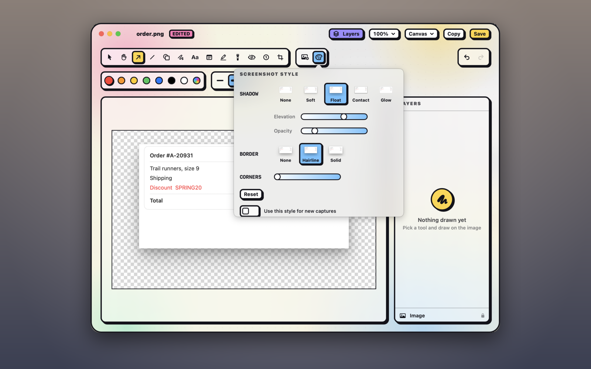

## Add a shadow, border or rounded corners

1. In the annotation editor, click **Style** in the toolbar.
2. Point at a preset to preview it on the canvas, and click to apply it. The arrow keys move between presets, previewing each, and <kbd>Return</kbd> applies the one you're on.

Nothing is styled until you ask. Each click is one undo step, and so is each slider drag. A shadow or border grows the canvas just enough to fit it, and removing it shrinks the canvas back.

**Shadow:** None, Soft, Float, Contact or Glow. Once there's a shadow, the **Elevation** and **Opacity** sliders fine-tune it. The light comes from above, so shadows fall below. On a coloured background the shadow takes a dark shade of it. On a transparent one it's black, and it's saved in the PNG, so it looks right wherever you paste it. Glow takes the colour of the image's edge.

**Border:**

- **Hairline** draws a one-pixel rim, light on dark content and dark on light, so a screenshot keeps its edge on a page of the same colour.
- **Solid** draws a line of one colour just outside the edge, following the rounded corners.
- **Outline** traces the shape of an image with see-through pixels, such as a logo or a cut-out, like a sticker. It shows only for those.

Solid and Outline come in three widths, **S**, **M** and **L**, in the palette colours. They start at M, in the colour of the border already there, or else white.

**Corners:** the slider rounds the corners.

**Reset** at the bottom puts the shadow, border and corners back to how new ones start, in one undo step. It's greyed out when they already are. It also makes the next mark, text or image of that kind start plain. On a screenshot it leaves **Use this style for new captures** as it is. The video editor's Style panel has the same **Reset**.

> [!NOTE]
> A window captured with its macOS shadow already has one, so Style shows **Uses macOS window shadow** instead of its choices. The image includes the shadow's see-through margin, which another shadow, a border or corners would go round. Pasted styles and **Use this style for new captures** leave it as it is.

## Style a mark, text or image

With something selected, **Style** acts on that instead of the screenshot:

| Selected | Style offers |
|---|---|
| Nothing: the screenshot | Shadow, border and corners. |
| A placed image | The same as the screenshot. |
| A shape, arrow, line, pen stroke or counter | A shadow or glow. Glow takes the mark's colour. |
| Text | A shadow or glow, and an outline round each letter, so it reads on a busy screenshot. The outline starts black or white, whichever stands out from the text. |
| A blur, pixelate, spotlight, highlight or note | Nothing. A note has a shadow of its own. |
| Several things, or a locked one | Nothing. |

Style is also greyed out while you type text.

The style you pick for an image, a mark or text is remembered: the next one of that kind you draw or add starts with it, even in a new editor window, until you pick **None**.

## Reuse a style

1. Select something and choose **Edit › Copy Style** (<kbd>⌥⌘C</kbd>).
2. Select something else and choose **Edit › Paste Style** (<kbd>⌥⌘V</kbd>).

With nothing selected, they copy from and paste onto the screenshot. **Edit › Apply Style to All Images** pastes onto the screenshot and every image you placed. Pasting is one undo step.

Each thing takes only what it can have: a shape keeps its own corners, and text takes only an outline as its border. Styles copied here paste in the video editor too, and the other way round. Pasting doesn't change the style that's remembered for new marks.

## Style every new capture

At the bottom of **Style**, with nothing selected, turn on **Use this style for new captures**. Shot saves the screenshot's current style, and every new capture then:

- opens in the editor with that style,
- is copied with it: the plain capture is copied straight away, and the styled one replaces it a moment later, unless you've copied something else since,
- shows styled in Quick Access a moment later, so copying or dragging the card uses the styled one.

The saved file stays plain, so you can always change the style.

- **To stop,** turn the switch off.
- **To save a different style,** style a screenshot differently and turn the switch on again.

> [!NOTE]
> The switch shows on only while this screenshot has the saved style. If you restyle the screenshot, it turns off, but new captures keep the saved style, and a line under the switch says so. To stop styling new captures from there, turn it on and then off.
