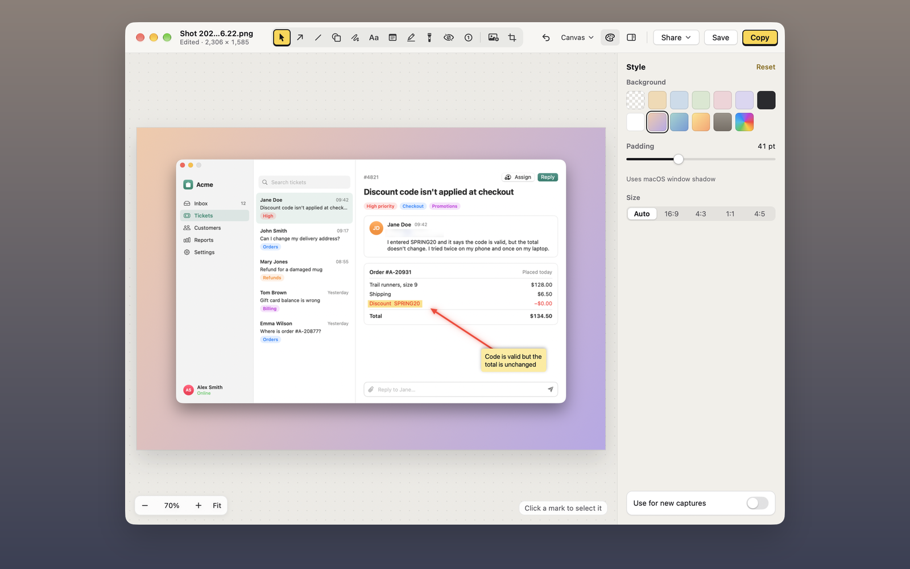

## Open the Style panel

In the annotation editor, click **Style** in the title bar. The Style panel opens beside the canvas, and clicking **Style** again closes it. It and the Layers panel take turns: opening one closes the other, so the canvas keeps its room.

Nothing is styled until you ask. Each click is one undo step, and so is each slider drag. **Reset** at the top of the panel puts everything it styles back to how a new capture starts, in one undo step, and is greyed out when there's nothing to put back.

## Give the screenshot a background

With nothing selected, the panel styles the whole picture, from the top:

- **Background** fills the space around the screenshot. Pick None (see-through, PNG only), one of seven colours, the Dusk, Sea or Citrus gradient, **Desktop**, or any colour from the rainbow swatch. Desktop uses your desktop picture, or a warm grey when Shot can't read it, such as with a dynamic wallpaper. A PNG starts see-through and a JPEG white.
- **Padding** adds up to 120 pt of background on every side of the screenshot. Marks that reach further still fit.
- **Corners** rounds the screenshot's corners.
- **Shadow** and **Border** are described below.
- **Size** grows the canvas to 16:9, 4:3, 1:1 or 4:5 around the screenshot, for slides and social posts. **Auto** fits the canvas to what's on it. Size only ever adds background, so nothing is cut off.

The padding goes round a crop rather than the whole screenshot, and **Canvas › Trim to Image** takes the padding and size off again.

## Add a shadow or border

Point at a preset to preview it on the canvas, and click to apply it. With keyboard navigation on, <kbd>Tab</kbd> moves between presets and <kbd>Space</kbd> applies one. A shadow or border grows the canvas just enough to fit it, and removing it shrinks the canvas back.

**Shadow:** None, Soft, Float, Contact or Glow. Once there's a shadow, the **Elevation** and **Opacity** sliders fine-tune it. The light comes from above, so shadows fall below. On a coloured background the shadow takes a dark shade of it. On a transparent one it's black, and it's saved in the PNG, so it looks right wherever you paste it. Glow takes the colour of the image's edge.

**Border:**

- **Hairline** draws a one-pixel rim, light on dark content and dark on light, so a screenshot keeps its edge on a page of the same colour.
- **Solid** draws a line of one colour just outside the edge, following the rounded corners.
- **Outline** traces the shape of an image with see-through pixels, such as a logo or a cut-out, like a sticker. It shows only for those.

Solid and Outline come in three widths, **S**, **M** and **L**, in the palette colours. They start at M, in the colour of the border already there, or else white.

**Reset** on a mark, text or image also makes the next one of that kind start plain. On a screenshot it leaves **Use for new captures** as it is. The video editor's Style panel has the same **Reset**.

> [!NOTE]
> A window captured with its macOS shadow already has one, so the panel shows **Uses macOS window shadow** in place of the shadow, border and corners. The image includes the shadow's see-through margin, which another shadow, a border or corners would go round. Its background, padding and size still work. Pasted styles leave it as it is.

## Style a mark, text or image

With something selected, the top of the panel styles that instead of the screenshot, under its name, such as **Selected shape**. The screenshot's background, padding and size stay below it under **Canvas**.

| Selected | The panel offers |
|---|---|
| Nothing: the screenshot | Background, padding, corners, shadow, border and size. |
| A placed image | The same as the screenshot. |
| A shape, arrow, line, pen stroke or counter | A shadow or glow. Glow takes the mark's colour. |
| Text | A shadow or glow, and an outline round each letter, so it reads on a busy screenshot. The outline starts black or white, whichever stands out from the text. |
| A blur, pixelate, spotlight, highlight or note | Nothing. A note has a shadow of its own. |
| Several things, or a locked one | Nothing but the canvas. |

While you type text, the panel offers only the canvas.

The style you pick for an image, a mark or text is remembered: the next one of that kind you draw or add starts with it, even in a new editor window, until you pick **None**.

## Reuse a style

1. Select something and choose **Edit › Copy Style** (<kbd>⌥⌘C</kbd>).
2. Select something else and choose **Edit › Paste Style** (<kbd>⌥⌘V</kbd>).

With nothing selected, they copy from and paste onto the screenshot. **Edit › Apply Style to All Images** pastes onto the screenshot and every image you placed. Pasting is one undo step.

Each thing takes only what it can have: a shape keeps its own corners, and text takes only an outline as its border. Styles copied here paste in the video editor too, and the other way round. Pasting doesn't change the style that's remembered for new marks.

## Style every new capture

At the bottom of the Style panel, with nothing selected, turn on **Use for new captures**. Shot saves the screenshot's current style, with its background, padding and size when it has them, and every new capture then:

- opens in the editor with that style,
- is copied with it: the plain capture is copied straight away, and the styled one replaces it a moment later, unless you've copied something else since,
- shows styled in Quick Access a moment later, so copying or dragging the card uses the styled one.

The saved file stays plain, so you can always change the style.

- **To stop,** turn the switch off.
- **To save a different style,** style a screenshot differently and turn the switch on again.

> [!NOTE]
> The switch shows on only while this screenshot has the saved style. If you restyle the screenshot, it turns off, but new captures keep the saved style, and a line under the switch says so. To stop styling new captures from there, turn it on and then off.
