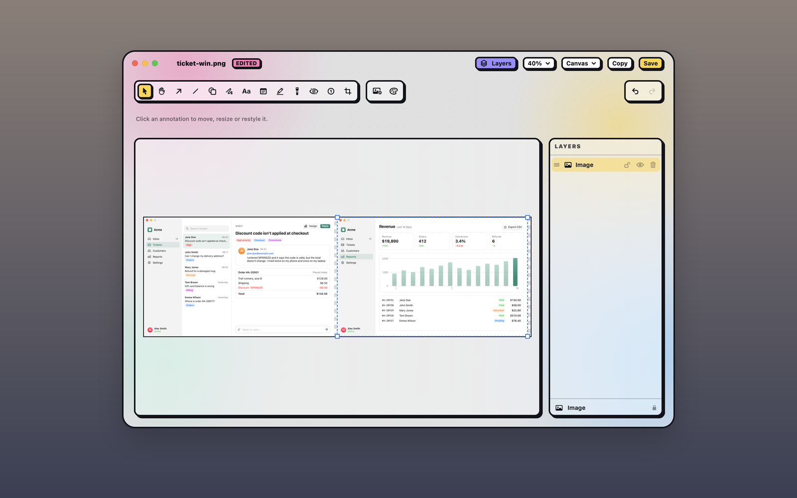

## Add an image

In the annotation editor, any of these places another image beside your screenshot:

- Click **Add an image** (<kbd>⇧⌘I</kbd>) and pick one of your recent captures, or **Choose File…** for any image files.
- Drag an image file, or a [Quick Access](#quick-access) card, onto the canvas. It's centred where you drop it.
- Press <kbd>⌘V</kbd> with an image on the clipboard.

A picked or pasted image goes beside the canvas, and the canvas grows to fit it.

## Move and resize it

Placed images keep their full resolution. Move, nudge, copy and delete them like any other mark. Drag a corner to resize one: it keeps its proportions, unless you hold <kbd>Shift</kbd> to stretch it freely.

A placed image starts with a soft shadow, so it stands out from the screenshot under it. Like the screenshot, it can have its own [style](#style-a-screenshot): select it and open **Style** to change its shadow, add a border or round its corners, or pick **None** to remove the shadow. The next image you place starts with the style you gave the last one, and **Reset** puts the soft shadow back. **Edit › Apply Style to All Images** gives every image the same one.

## Crop a placed image

To trim an image's own edges, such as a pasted screenshot's toolbar:

1. Double-click the image. You can also select it and press <kbd>C</kbd>, or right-click it and choose **Crop Image**. Once it has a crop, clicking the round crop badge on its top-right corner does the same; the badge shows while the pointer is over the image or it's selected.
2. Drag the handles. The part cropped off shows dimmed, and **Aspect** and **Reset** work as they do when you [crop the screenshot](#crop).
3. Press <kbd>Return</kbd> to apply the crop, or <kbd>Esc</kbd> to cancel.

Double-click it again to drag the edges back out. Its shadow, border and rounded corners go around the cropped edge, and resizing it scales what's left. Copies, duplicates and pastes keep the crop, and **Paste Style** leaves it alone.

> [!NOTE]
> The crop of the whole screenshot still applies on top, so it can cut off part of a placed image too. In [Layers](#layers), a placed image with its own crop shows a **Crop** badge, and **Reset Crop** on its row shows the whole image again.

## Make room on the canvas

The **Canvas** menu in the title bar, after Undo, tidies the canvas once images are placed. **Fit to Content** fits it to everything on it, and **Trim to Image** trims it back to the screenshot. **Background…** opens the Style panel to choose what fills the space around the images. In a narrow window the menu is a button with a dashed rectangle. See [Grow or trim the canvas](#grow-or-trim-the-canvas).

## Reopen a combined image

Save, then open the saved version again from the gallery or Quick Access, and the placed images and marks are still separate layers you can move, crop or delete. Shot keeps them on this Mac, not in the saved file (see [Reopen a saved version](#reopen-a-saved-version)). **Edit › Flatten** makes it one plain image.
