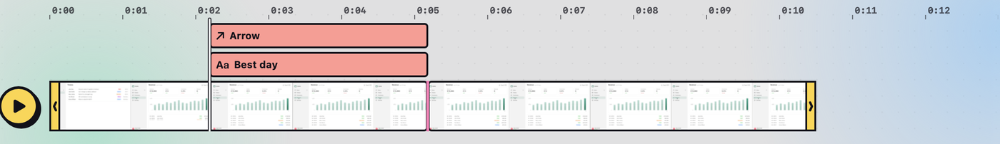

## Open the video editor

- The scissors button, **Edit Video**, on a recording's [Quick Access](#quick-access) card.
- **Edit Video** in the [gallery](#find-your-captures), or a double-click on the recording there.
- A [`shot://edit-video?path=…`](#url-scheme) link.

## Play and move around

Under the video, the controls area shows **Play**, the playhead's time and the edit's length ("0:02.40 / 0:10.50"), then **Split**, **Cut**, **Trim idle** and **Add media**, and zoom at the right. Under that is the timeline: a ruler, then each lane with its name on the left. A plain recording has a **Video** lane and, if it has sound, a **Sound** lane. Annotations add **Draw** or **Text** lanes above the video, and added files add lanes of their own. Hover over a lane's name to lock it, hide it or mute it.

| Press | To |
|---|---|
| <kbd>Space</kbd> | Play or pause. |
| <kbd>←</kbd> <kbd>→</kbd> | Step one frame. |
| <kbd>⇧←</kbd> <kbd>⇧→</kbd> | Step one second. |
| <kbd>Home</kbd> <kbd>End</kbd> | Go to the start or the end. |

Click the ruler to move the playhead. Drag the zoom slider, click **−** and **+**, pinch, or press <kbd>⌘+</kbd> and <kbd>⌘−</kbd> to zoom the timeline, and press <kbd>⌘0</kbd> to fit it to the window.

## Trim the ends

Drag the yellow handles at either end of the Video lane. What you trim off stays greyed out, so you can drag it back. The playhead follows the handle and stays on the new start or end when you let go, so the video shows the exact frame the trim lands on.

### Trim idle time

Most recordings start with a few seconds of reaching for the mouse and end with a few of reaching for Stop. Click **Trim idle**, or choose **Edit › Trim Idle Time**, and Shot moves both handles to where things start and stop changing on screen, with a little time to spare either side. Anything you say stays in, even over a still screen.

- It's one step, so <kbd>⌘Z</kbd> puts the handles back.
- It only moves the handles in, so anything you've already trimmed off stays off.
- It compares frames on your Mac. Nothing is uploaded, and a pointer moving over a still screen counts as idle.
- It works while your edit is only trims and cuts of one recording.

## Cut out a section

1. Hold <kbd>Shift</kbd> and drag along the timeline to select a section.
2. Click **Cut**, or press <kbd>Delete</kbd>.

A black **CUT** badge on the Video lane shows where each cut is and how long it was, such as "CUT 1.2s".

## Split and rearrange

- **Split** (<kbd>S</kbd>) splits the clips under the playhead.
- **Cut** (<kbd>⌫</kbd>) cuts out the selected section, or else the selected clip, and closes the gap.
- **Snap** (<kbd>N</kbd>), the button with two arrows beside zoom, snaps the playhead, and clips you drag or trim, to clip edges and the playhead.

Clips that meet, after a split or a cut, show a small gap between them. The selected clip has a blue outline.

## Add video or sound

- **Add media › Add Video or Audio at Playhead…**, or dropping a file on the window, puts its picture on a new lane above the main track and its sound on a lane of its own.
- **Add media › Add Video to End…** adds a video to the end of the Video lane.

Drag a clip on another lane to move it in time, or drag its edges to trim it. Sound lanes show a waveform, which grows and shrinks with the clip's volume.

## Move, scale and rotate a clip

Select a clip, the recording included, while the playhead is on it, and a dashed outline in your Mac's accent colour appears round it on the video, with a white handle on each corner and a round one on a short stem above it:

- Drag inside the outline to move the clip.
- Drag a corner to scale it about its centre.
- Drag the round handle to rotate it. On a clip that fills the video, there's no room above it, so the handle sits just inside the top edge.

Each drag is one undo step.

## Crop the video

- **The whole video:** with nothing selected, press <kbd>C</kbd>, or click **Crop** under **Frame** in the Inspector.
- **One clip:** select it and press <kbd>C</kbd>, double-click it on the video, or click **Crop** in the Inspector.

Cropping looks and works as it does when you [crop a screenshot](#crop). What's cropped off fades into the background, and the crop has a thirds grid and dark handles on its corners and sides (light ones in Dark Mode). Drag a handle to resize the crop or drag inside it to move it, and hold <kbd>Shift</kbd> to keep its shape. A crop of a turned clip turns with it. The bar under the video holds **Aspect** (Free, 1:1, 4:3 or 16:9), the size the crop keeps in pixels, **Reset**, **Cancel** and **Crop**. **Reset** or <kbd>Delete</kbd> shows everything again. <kbd>Return</kbd> or **Crop** applies the crop as one undo step, and <kbd>Esc</kbd> or **Cancel** leaves it as it was.

- **Cropping the video changes its size.** Cropping off the menu bar of a 1920 × 1080 recording gives a smaller video, not a scaled-up one, and MP4 and GIF exports come out at the cropped size. Sizes round down to even numbers. With nothing selected, the Inspector shows the size under **Frame**, and **Reset** at the top of the panel takes the crop off.
- **A cropped clip** still moves, scales and turns as a whole, about the middle of its whole picture, and its corners, shadow and border follow the cropped edge. **Reset Crop** in the Inspector shows all of it again.

> [!TIP]
> Crops aren't animated. For a zoom over time, [animate](#animate-and-annotate-a-recording) the clip's scale and position.

## Undo, delete and cancel

- <kbd>⌘Z</kbd> undoes and <kbd>⇧⌘Z</kbd> redoes, wherever you clicked last. In a text field, <kbd>⌘Z</kbd> first undoes your typing, then finishes it and undoes your last change.
- <kbd>Delete</kbd> takes away the selected keyframe, or else the selected section, or else the selected clip or annotation.
- <kbd>Esc</kbd> cancels an export, or else clears the selected section, or else deselects, or else stops annotating, or else closes the Export panel.

## Save

**Save** (<kbd>⌘S</kbd>) replaces the recording with your trimmed version, without re-encoding where it can, and copies it. Under the file name, the title bar shows the recording's length until you change something, then what you've changed, such as "Edited · trimmed" or "Edited · 1 cut · 2 annotations".

Once your edit is more than trims and cuts, the button reads **Save Copy** instead, and writes a new file next to the recording. An import, annotation, keyframe or crop, a moved or styled recording, a changed volume, reordered clips, or a hidden or muted track each switches it to **Save Copy**.

**Save** and **Save Copy** each copy the file they write. **Export**, the yellow button at the right of the title bar, opens the Export panel, whose own button writes and copies the export. To copy the edited video without saving it, press <kbd>⌘C</kbd>; it includes everything you've added. To make an MP4 or GIF with other settings, see [Export a video or GIF](#export-a-video-or-gif).

Closing the window asks whether to save, or to save a copy, when you've changed anything since you last saved, saved a copy or exported.
