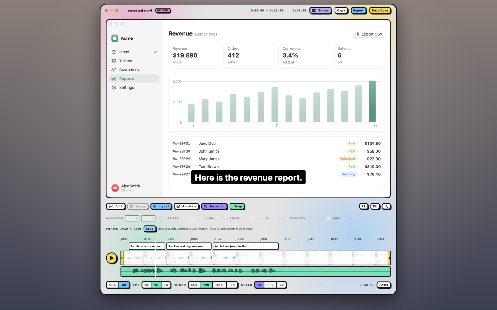

## Draw over the video

1. In the video editor, click **Annotate**.
2. Pick a tool and draw, as in the [annotation editor](#annotate-a-screenshot): arrows, shapes, text, blur and more. Crop and the hand tool aren't here; to crop the video, see [Crop the video](#crop-the-video).
3. To add a picture, use the image button in the same toolbar.

Each annotation starts at the playhead and shows for 3 seconds. It goes on the first annotation lane that's free at that time and not locked, or else on a new lane.

## Add captions

On macOS 26 or later, Shot can turn what you said while recording into captions, so a walkthrough or a GIF makes sense without sound.

1. Record with the microphone on, then open the recording in the video editor.
2. Choose **Edit › Add Captions**. Shot listens to the recording on your Mac; nothing is uploaded.
3. Play it back. Each caption is a text clip on its own lane: white text on a dark box, centred near the bottom, at most two lines.

Speech recognition gets some words wrong, especially names and jargon, so check the captions before you share. To fix one, click **Annotate** and double-click it on the video. Drag a caption clip's edges to change when it shows, or delete it. <kbd>⌘Z</kbd> removes them all at once. Captions follow your trims and cuts, and only the part you kept gets them.

## Fine-tune with the Inspector

Click **Inspector** to see the selected clip's or annotation's properties:

- **Position**, **scale**, **rotation** (**Turn**) and **opacity**.
- **Volume** for a clip on a sound lane, from 0 to 200%.
- **Drawn**: how much of an arrow, line or pen stroke is drawn.

**Reset** puts all of these back to how a new clip starts and clears its keyframes, in one undo step. It stays greyed out while the clip is untouched, and leaves the crop and style alone.

## Animate with keyframes

A keyframe pins a property to a value at a moment in time, and the editor moves smoothly between them.

1. Move the playhead to where the change should start, and click the diamond beside a property in the Inspector.
2. Move the playhead again and change the property. Once a property has a keyframe, changing it anywhere else adds one there.

<kbd>K</kbd> keys everything the selected clip or annotation can animate, at the playhead, or takes those keyframes away. Clicking a diamond again takes its keyframe away.

Keyframes show as diamonds on the lane:

- Click one to go to it and choose its **Easing**: Linear, Ease in, Ease out, Ease in-out or Spring.
- Drag it to move it, or press <kbd>Delete</kbd> to take it away.

> [!TIP]
> For the common animations, use the ready-made ones: **Fade In**, **Fade Out**, **Pop**, **Slide In** and **Draw On** add their keyframes at the start or end, and **Clear Keyframes** removes them all.

## Arrange lanes

The annotation and picture lanes above the main track are the layers, topmost first. A blur, pixelate or spotlight affects the lanes under it, video included, not those over it.

- **Move to another lane:** drag an annotation or an imported clip up or down. Drop it between lanes, or on a lane that's locked, taken at that time or holds the other kind, and it gets a new lane of its own.
- **Move up or down:** <kbd>⌘]</kbd> and <kbd>⌘[</kbd> move the selection a lane up or down, and <kbd>⌥⌘]</kbd> and <kbd>⌥⌘[</kbd> to the top or bottom.
- **Rename:** double-click an annotation's label, or right-click it and choose **Rename**, as in the annotation editor's [Layers](#layers). The name is kept with the project and never drawn in the video.
- **Lock, hide, mute or delete:** right-click a lane, or point at its left edge for the same buttons. A locked lane is left alone by **Split** and new annotations.

## Style clips and annotations

Select a clip or an annotation and click **Style** in the **Inspector** for the same shadows, borders and corners as when you [style a screenshot](#style-a-screenshot).

- A clip can have rounded corners, a shadow, and a Hairline or Solid border. So can the recording itself, which makes the video drawn rather than only trimmed.
- The corners, shadow and border grow and shrink with the clip's scale, and **Pop** and **Slide In** lift the shadow briefly as the clip comes in.
- On a clip, Glow takes the colour of the frame's edge, and a Hairline is light on a dark frame and dark on a light one. The edge is read once a second.
- Pointing at a preset, or moving to it with the arrow keys, previews it. A recording you've only trimmed shows a clip's new style a moment after you click instead.

Each click is one undo step, and so is each slider drag. **Edit › Copy Style** (<kbd>⌥⌘C</kbd>) and **Paste Style** (<kbd>⌥⌘V</kbd>) work as in the annotation editor, and a style you give an annotation is remembered for the next one of its kind.
