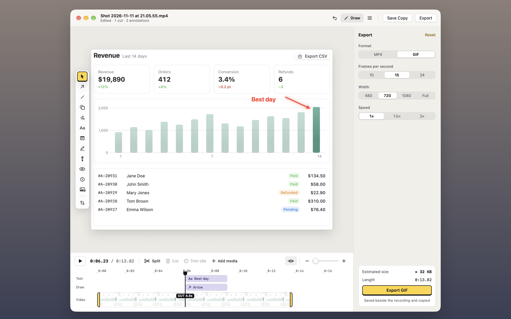

## Export

In the video editor, click **Export** at the right of the title bar to open the Export panel beside the video. Click **Export** again, or press <kbd>Esc</kbd>, to close it. The Export panel and the Inspector share the space beside the video, so opening one closes the other. In the panel, choose:

- **MP4** or **GIF**.
- **Speed:** 1×, 1.5× or 2×. For an MP4, speed is available only while the edit is trims and cuts, when Save reads **Save**, not **Save Copy**.
- **For a GIF:** 10, 15 or 24 frames per second, and 480, 720 or 1080 pixels wide, or the recording's own width (**Full**). It's never wider than the recording.
- **For an MP4:** **Mute** to leave the sound out.

Click **Reset** at the top of the panel to put all of these back to how new exports start. It's greyed out when they already are, and **Undo** brings your choices back.

Annotations show in both. A text box's fill is solid, so in a GIF it adds to the size only when its words change.

The card at the foot of the panel shows the estimated file size and how long the export plays for. Click **Export GIF** or **Export MP4** under them to write a new file next to the recording and copy it. While it exports, the card shows how far it's got, and **Cancel**, or <kbd>Esc</kbd>, stops it.

> [!NOTE]
> A GIF keeps the first 60 seconds of what plays, so 120 seconds of video at 2×. An MP4 that's re-encoded is H.264, or HEVC when H.264 would drop frames: a 120 fps recording, or one above 30 fps that's larger than 2560 × 1600, such as a full Retina screen.

> [!TIP]
> For a quick GIF without opening the editor, click **Export GIF** on the recording's [Quick Access](#quick-access) card. It uses the frame rate and width you last chose here.

## Reopen an edit later

**Save Copy** and **Export** keep your edit as a project: every lane, clip, annotation, keyframe and style. Open the copy or the export later, from the gallery, Quick Access or a `shot://edit-video` link, and it opens as the recording with the edit still live, so you can change it and save again.

A GIF works the same way: **Edit** on it in the gallery, or a `shot://annotate` link, opens its project in the video editor.

- The project follows the recording when you move or rename it. If the recording is gone, or **Save** has since trimmed it, the copy opens as itself.
- An imported file that has moved is found again if it was beside the recording, or in a folder inside the recording's folder, and moved with it. One that can't be found is left out, with a message naming it, and the rest of the edit opens.
- **Save** on an edit that's only trims and cuts replaces the recording itself, so there's no project to keep.
- To edit a copy or export as itself instead, choose **Edit › Flatten**, or open the recording. A flattened GIF opens in the annotation editor.

Shot keeps projects in its own Application Support folder, not in your files, so a video you share never carries them.
