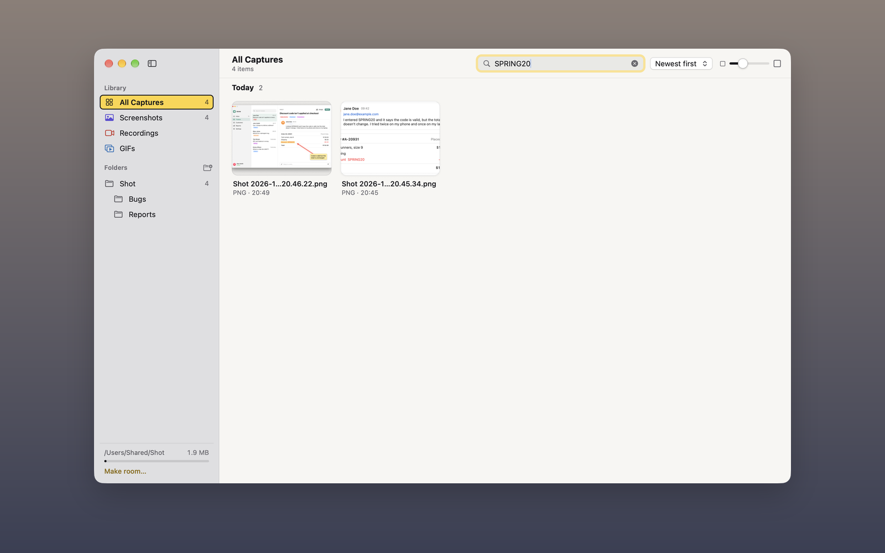

## Open the gallery

Choose **Gallery** in Shot's menu bar menu, click **Open Gallery** at the foot of the Settings sidebar, or open [`shot://gallery`](#url-scheme). The gallery has its own window, which opens where you last left it and at the same size.

For your last few captures you don't need the gallery. The menu bar menu shows your four newest under **Recent**: click one to open it in its editor, or drag it into another app. With the keyboard, press <kbd>↓</kbd> until the row is highlighted, then <kbd>→</kbd> for a list of them.

It shows every image, movie and GIF in your save folder and the folders inside it, whether Shot made it or not, and stays up to date as you capture. Captures taken with saving turned off aren't in it. To group captures into folders or tag them, see [Organise your captures](#organise-your-captures).

## Search, filter and sort

- **Filter** by picking **All Captures**, **Screenshots**, **Recordings** or **GIFs** under Library in the sidebar. Each shows how many captures it holds.
- **Search** (<kbd>⌘F</kbd>) by file name, and for a screenshot, by the text in it too. Case and accents don't matter.
- **Sort** by **Newest first**, **Oldest first**, **Name** or **Largest first**. Sorted by date, captures are grouped into Today, Yesterday, This Week, This Month and then each older month.
- **Resize thumbnails** with the slider, or <kbd>⌘+</kbd> and <kbd>⌘−</kbd>.

Under each thumbnail are its name, its file type and, depending on the sort, the time it was taken, its size or its date. A dot shows its first tag. Recordings show their length in the corner, and GIFs say GIF.

> [!NOTE]
> **How text search works:** Shot reads the text in each screenshot on your Mac, at low priority in a separate process, a few seconds after it lands in the save folder. It pauses while you record and doesn't start in Low Power Mode. The first time, it reads the screenshots already there, newest first, which can take a few minutes for a big folder. What it reads stays in Shot's Application Support folder, never in your files. Recordings and GIFs are found by name only.

## Select

Click, <kbd>⌘</kbd>-click or <kbd>⇧</kbd>-click, press <kbd>⌘A</kbd> or use the arrow keys. You can also click the circle in the corner of a thumbnail to add it. Selected thumbnails have a blue outline and a tick. Press <kbd>⌘⇧A</kbd> or <kbd>Esc</kbd>, or click an empty part of the grid, to deselect everything.

While something is selected, a bar floats at the bottom of the gallery. It says how many are selected and has **Edit**, **Move to…**, **Tag**, **Show in Finder**, the Trash button and **Copy**.

## Open, copy and share

| To | Do this |
|---|---|
| Open in an editor | Double-click it, click the pencil or scissors on a hovered thumbnail, or select it and press <kbd>Return</kbd> or click **Edit**. Screenshots open in the [annotation editor](#annotate-a-screenshot) and recordings in the [video editor](#edit-a-recording). Shot asks first if you open more than 8. |
| Preview | Select it and press <kbd>Space</kbd>, or right-click it and choose **Preview**. See [Preview a capture](#preview-a-capture). |
| Copy | Click **Copy** in the selection bar, or press <kbd>⌘C</kbd>. |
| Drop it in another app | Drag the thumbnail. |
| Show the file | Click **Show in Finder**. |
| Delete | Click the Trash button in the selection bar, or press <kbd>⌘⌫</kbd>. <kbd>⌘Z</kbd> puts it back, and so can Finder. |

Right-click for the same actions, plus **Preview**. On a single item, right-click also offers **Rename…**, **Export GIF** for a video, and [**Pin**](#pin-a-screenshot) for a screenshot.

A GIF opens in an editor only if the video editor exported it, and then opens its [project](#reopen-an-edit-later).

## Preview a capture

Select a capture and press <kbd>Space</kbd> to see it large in the gallery window, with a details panel beside it. The toolbar shows its name and where it is in the grid, such as "3 of 248", with **Edit** and **Copy**. Recordings play, and GIFs animate.

- Press <kbd>←</kbd> or <kbd>→</kbd> for the previous or next capture in the grid, and <kbd>Space</kbd> or <kbd>Esc</kbd>, or the back arrow, to go back to the grid. The capture you were on stays selected.
- <kbd>Return</kbd>, <kbd>⌘C</kbd>, <kbd>⌘R</kbd> and <kbd>⌘⌫</kbd> work on the capture shown, as they do on a selection.
- The details panel says when it was taken, its size in pixels and on disk, its folder, and how many edits were saved beside it, such as "Original + 1 edit".
- **Tags** lists its tags. Click **+ Add tag** to add or remove one.
- **Text in this screenshot** shows the text that search found in it. While you're searching, your search is highlighted there and in the image, and the panel counts the matches.
- **Copy path for an AI assistant** copies where the file is on your Mac, for an assistant that can open files. **Show in Finder** shows the file.
