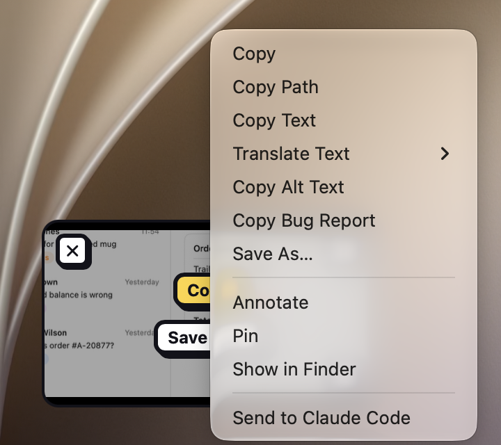
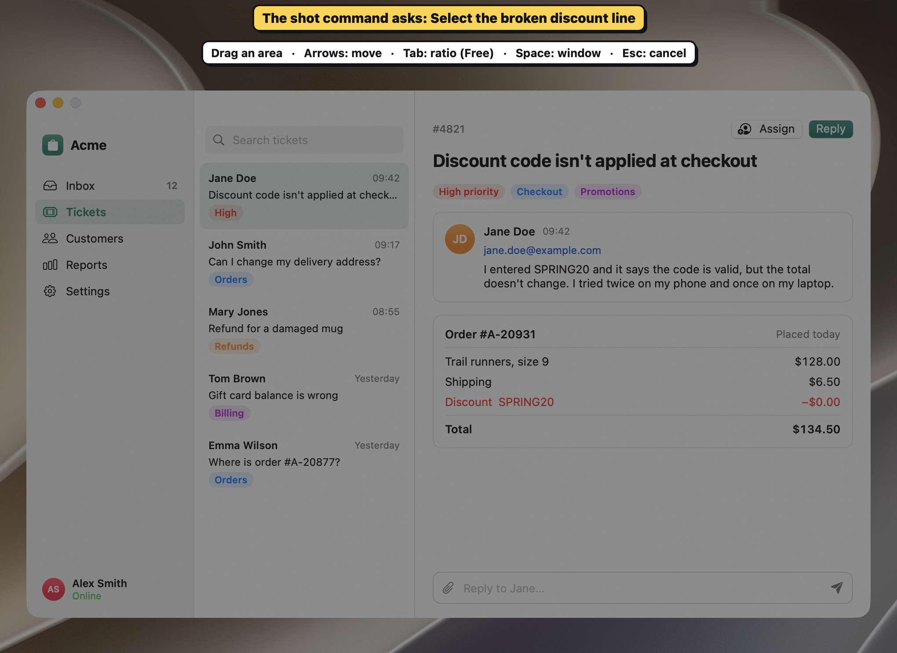

Coding agents such as Claude Code, Codex and Cursor can do more with Shot than read a pasted image. You can send one a capture as a task, and with your permission it can read your captures, edit them, and screenshot or record a window such as the iOS Simulator to check its own work.

If you only paste screenshots into an assistant like Claude or ChatGPT, see [Share a capture with an AI assistant](#share-a-capture-with-an-ai-assistant) instead.


## Set up your agent

Everything is in **Settings › Agents**, and every switch there starts off. Turn on only what you need:

1. **Send to Agent** opens your agent with a marked-up capture as its task. See [Send a capture to your coding agent](#send-a-capture-to-your-coding-agent).
2. **Hand captures to agents** records, inside each screenshot, where it came from and what you marked. See [Hand captures to agents](#hand-captures-to-agents).
3. **Add Shot's MCP server** to your agent: click **Install** beside it on the **MCP server** card. Then the agent can fetch your captures itself. See [The MCP server](#the-mcp-server).
4. **Install the `shot` command,** for agents and scripts that work in a shell. See [The shot command line](#the-shot-command-line).
5. **Let agents capture and record** lets an agent screenshot or record a window. See [Let an agent capture and record](#let-an-agent-capture-and-record).

The reference for the server, the command and the JSON edits is [Automation reference](#automation-reference).

## Send a capture to your coding agent

You mark up a screenshot because something's wrong: an arrow at a button and a note saying "this should be bold". **Send to Agent** turns that into a task. It opens your coding agent in a terminal, in the project folder you choose, with the screenshot and a short summary of your marks, so you don't paste the image and retype what your marks already say.

The agent runs on your own account, as if you'd started it yourself. Shot needs no key or sign-in, and sends nothing until you choose **Send to Agent**.

### Set it up

1. Open **Settings › Agents** and turn on **Send to Agent**.
2. Choose your agent: **Claude Code**, **Codex**, **Cursor** or **Custom**. Shot finds the agent's command on your Mac and shows where it is. If it says it couldn't find it, install the agent, then open Settings again.
3. Choose the terminal it opens in: Terminal, iTerm, Ghostty or Warp. Shot lists the ones you have.
4. Choose the **working folder**, usually your project. The agent starts there and works on what's in it.

### Send a capture

1. Take a screenshot and mark it up. Add a note with what you want done, such as "make this 8pt from the edge".
2. Right-click its Quick Access card, or its tile in the gallery, and choose **Send to Claude Code** (or your agent's name). In the editor, it's in the **File** menu.
3. A terminal window opens with the agent running and your task in it. When the agent finishes, the window stays open in your working folder.



From the editor, Shot saves your changes first, so the agent gets the version with your marks. It always gets the saved file with the marks drawn on, never the original under a blur.

> [!TIP]
> Send to Agent has no shortcut until you give it one. It never runs on its own, and it doesn't change what happens when you take a screenshot.

### Send to an agent that's waiting

When an agent you're already talking to asks for a screenshot, through Shot's [MCP server](#the-mcp-server), it waits for you to send one. Shot shows a note saying so, and the menu item names it, such as **Send to Claude Code**.

1. Take the screenshot and mark it up.
2. Choose **Send to Claude Code** on its Quick Access card, in the editor or in the gallery.

The capture and your notes go straight to that agent, in the conversation you're already having, rather than to a new terminal. This works even with **Send to Agent** off in Settings. If the agent stops waiting, the next send opens your terminal as usual.

### What the agent gets

Your notes come first, as the task. Then the file's path and a few lines about it:

```
Make "Open at login" bold
Screenshot from Shot: /Users/you/Pictures/Shot/Shot 2026-10-22 at 09.14.03.png
Open the image first; the user's marks are drawn on it.
Captured from Safari, window "Settings". 1664×1263 px, 1 pt = 2 px.
What the user marked (pixels, top-left origin):
- arrow from (900, 500) to (700, 300), red, pointing at "Open at login"
- rectangle at (560, 140), 160×45, yellow, around "General"
```

- Shot reads the text in the screenshot, on your Mac, to say what each arrow points at and what each box surrounds.
- Up to 10 marks are listed. Blurred and pixelated areas are counted, and their text is never quoted.
- With no notes, it starts with "Here's a screenshot I marked up:".
- The app, window and marks come from the record Shot keeps inside each screenshot, so they're there only with [Hand captures to agents](#hand-captures-to-agents) on. With it off, the agent gets the path and the "open the image first" line.
- If Shot's [MCP server](#the-mcp-server) is set up for the agent, the prompt tells it to call `find_text` for the rest of the text.

> [!NOTE]
> The agent sends what it reads to its model provider, the same as anything else you show it. Blur private details first.

### A custom agent

Choose **Custom** to run any command. Shot fills in:

- `{path}`: the screenshot
- `{dir}`: the folder it's in
- `{prompt}`: the task and summary above

For example, `gemini -i "@{path} {prompt}"`. If you leave `{prompt}` out, Shot adds it at the end. Use the placeholders bare or inside double quotes, not single quotes.

### How it works

Shot writes a small script, readable only by you, to its folder in Application Support, and opens it in your terminal. The script starts in your working folder, runs the agent with the prompt, then deletes itself and leaves a shell open. The prompt goes to the agent as it is, so quotes, `$` and new lines in your notes can't run as commands. Opening a script this way needs no permission to control your terminal.

To send from a script, or another app, use [`shot://send-to-agent?path=<file>`](#url-scheme). It works only while **Send to Agent** is on.

## Hand captures to agents

Turn on **Hand captures to agents** in **Settings › Agents**. Shot then records, inside each screenshot you take or save from the editor, which app and window it came from and what you marked. Agents read it through the [MCP server](#the-mcp-server) or `shot info`. The format is in [The capture record](#the-capture-record).

- A copied capture is also kept as a file, even with **Save to folder** off, so the agent can fetch it. With saving off, that file stays in a temporary folder for about a day: Shot deletes older ones when it launches.
- With the setting off, Shot records nothing.
- Recordings have no record.

> [!NOTE]
> Window titles can be private, which is one reason this is off until you turn it on.

## Let an agent capture and record

An agent can take its own screenshot or recording of a window, such as the iOS Simulator or the app it's building, so it can check its work without asking you: "record the Simulator while the UI test runs, then show me what happened."

Screen Recording access belongs to Shot, not to your terminal, so the agent asks the running Shot app, through `shot capture`, `shot record`, or the MCP server's `capture_window` and `record_window` tools.

### Allow captures and recordings

Turn on **Let agents capture and record** in **Settings › Agents**. It starts off, and it's separate from **Hand captures to agents**. While it's off, Shot refuses every agent request except [asking you to pick](#ask-you-to-pick).

Each time an agent captures or records, Shot shows a notice at the bottom of the screen, such as **An agent took a screenshot of Simulator** or **An agent is recording Simulator**, so you always know.

### Screenshot a window

The agent names the window by a few words of its title or its app, such as `Simulator`, or by its app's bundle ID, such as `com.apple.iphonesimulator`. `shot windows` and the `list_windows` tool list the open windows and the displays to pick from.

```sh
shot capture --window "Simulator"
```

Shot captures that window live, even when other windows cover it, and never brings it forward or takes focus. The agent can also:

- take a whole display,
- keep only part of a window or display (a `rect` in points from its top-left corner),
- leave out the window's shadow,
- wait up to 30 seconds for an animation to finish first.

The screenshot is saved to your capture folder, with a record inside it of which app and window it came from. Nothing else happens: no sound, no copy, no Quick Access card, no editor.

### Record a window as it runs

```sh
shot record --window "Simulator" --duration 10
```

An agent's recording:

- leaves out the microphone and the camera. System audio follows **Settings › Recording**.
- always shows the region border and the recording controls, whatever **Settings › Recording** says, so you can pause, stop or discard it.
- stops itself after 10 minutes.
- is saved to your capture folder without being copied, and without a Quick Access card or confetti.

An agent can only stop its own recordings, never one you started. A recording of part of a window records that part of the screen, so a window in front of it shows too.

### Record while a command runs

```sh
shot record --window Simulator -- xcodebuild test …
```

This records only while the command after `--` runs, so a failed run can't leave the recording going. The command's input and output pass straight through, and <kbd>⌃C</kbd> reaches the command; the recording stops once it exits.

When the command exits, `shot` prints the recording with the command's `exitCode`, and exits with that code, so `&&` chains still work. If the command succeeds but the recording isn't saved, `shot` exits with the recording's error code instead. If the command can't start, `shot` exits with 127 when it isn't found, or 126 otherwise, as a shell does.

### Mark a moment

While its recording runs, an agent can mark a moment with `shot record --mark "tapped Login"` or `record_window`'s `mark` action. The key frames from `get_frames` and `record_window` then include the frame at each mark, with its label.

Marks are kept by Shot, in `~/Library/Application Support/dev.lorcan.Shot/`, not inside the video, so a recording you share doesn't carry them. Moving or renaming the recording loses them.

### Ask you to pick

An agent can also ask **you** to pick what it should see, with `shot pick --prompt "Select the broken toolbar"` or the `ask_for_capture` tool.



1. Shot opens its usual area selection, with the agent's prompt and name above the hint, such as **Claude Code asks: Select the broken toolbar**.
2. Drag across the area, or press <kbd>Space</kbd> and click a window.
3. Shot saves the screenshot to the capture folder, as it does an agent's own, and hands it back to the agent.

<kbd>Esc</kbd> cancels, and the selection closes by itself if you don't pick within the timeout, 60 seconds by default. Since you make the selection, this works with **Let agents capture and record** off.

### Privacy and safety

- Shot notes who asked for each screenshot, recording or edit an agent makes: the `shot` command or the MCP server, the command or tool, and the agent's name as it gives it to the MCP server. Like layers, this is kept in Shot's Application Support folder, never in the file, so a capture you share doesn't say an agent made it.
- If Shot isn't running, `shot capture` opens it in the background first.
- Shot only answers requests from your own user account, over a socket in `~/Library/Application Support/dev.lorcan.Shot/`.

> [!WARNING]
> Whatever an agent reads goes to that agent's model provider. Blur or pixelate anything private before you hand a capture over, or have the agent hide emails, tokens and card numbers with `shot redact --detect` or the `redact` tool. It finds only the ones it can read, so check the result.
