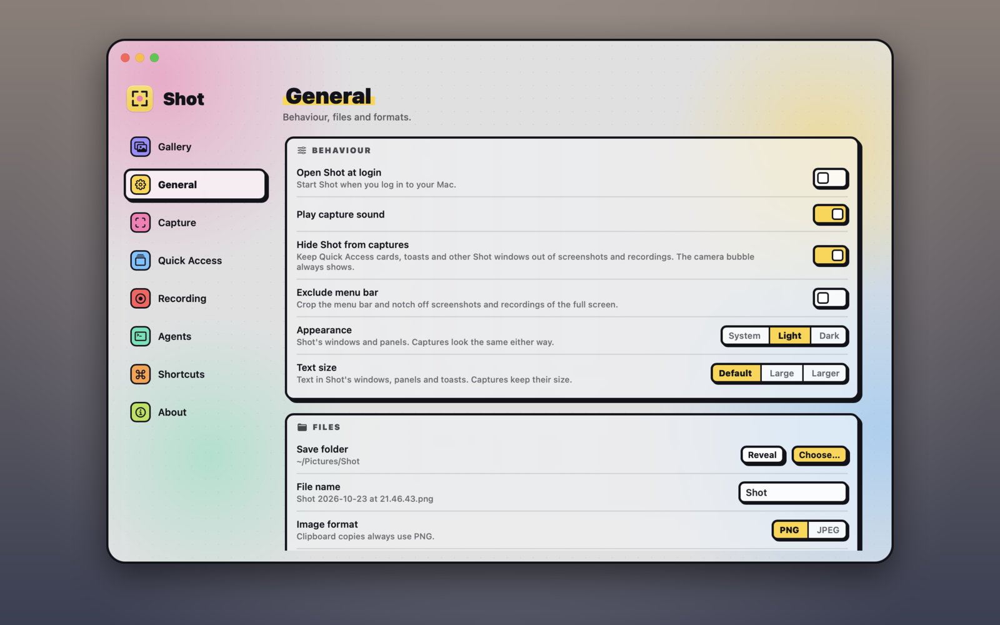
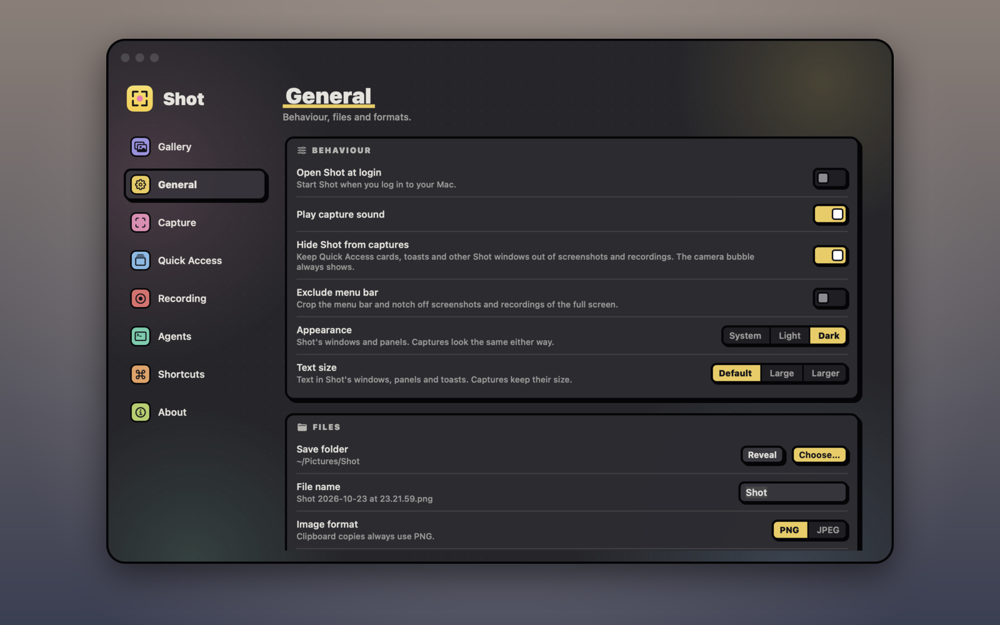

## Open Settings

Click Shot's menu bar icon and choose **Settings…**, or press <kbd>⌘,</kbd> while a Shot window is in front. To open a particular section, use [`shot://settings?section=recording`](#url-scheme), or any section name below.

## What each section controls

| Section | What you can change |
|---|---|
| Gallery | The [gallery](#find-your-captures) |
| General | Open Shot at login, the capture sound, hiding Shot from captures, cropping the menu bar off captures of the full screen, light or dark appearance (or following your Mac), the text size of Shot's own windows (macOS's Accessibility › Text size doesn't reach other apps), the save folder, the file name, PNG or JPEG, and scaling Retina captures to 1× |
| Capture | What happens after a capture (save, copy, Quick Access, or the editor), the magnifier, the crosshair, the cursor, and window shadows |
| Quick Access | The screen corner and how long cards stay |
| Recording | Adjust before recording, the countdown, frame rate, cursor, clicks, region outline, copying to the clipboard, the microphone and its input (with a **Test**), system audio, and the camera bubble's camera (with a **Preview**) and size. It also sums up the GIF settings the video editor last used. |
| Shortcuts | The macOS screenshot keys and every global shortcut |
| About | The version, updates, permissions, the save folder, links to the code and its licence, this guide, the acknowledgements, to report a bug and to sponsor Shot, and resetting all settings |

## Use dark mode

Shot's windows and panels follow your Mac's light or dark appearance. To pick one yourself:

1. Open **Settings › General**.
2. Next to **Appearance**, choose **System**, **Light** or **Dark**.

> [!NOTE]
> This changes Shot's own windows and panels only. Your captures look the same either way.

## Reset everything

In **Settings › About**, click **Reset**, then **Click to confirm**. It restores every setting and shortcut. Your captures stay.
