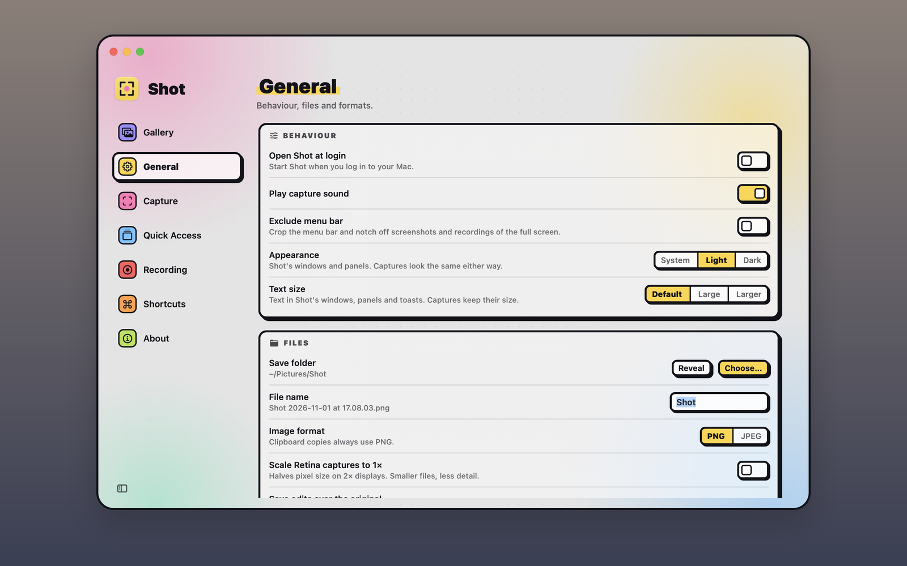
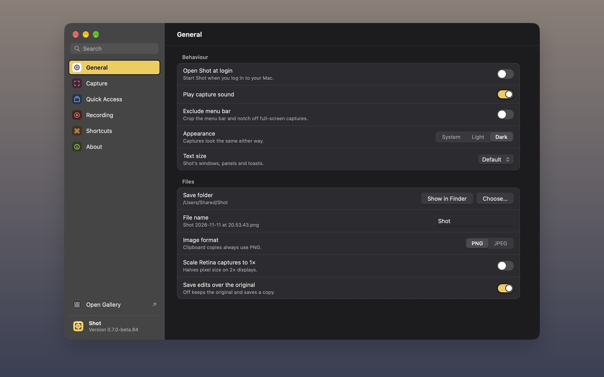

## Open Settings

Click Shot's menu bar icon and choose **Settings…**, or press <kbd>⌘,</kbd> while a Shot window is in front. To open a particular section, use [`shot://settings?section=recording`](#url-scheme), or any section name below.

The [gallery](#find-your-captures) has its own window. **Open Gallery**, at the foot of the Settings sidebar, opens it.

Use <kbd>↑</kbd> and <kbd>↓</kbd> to move between sections. The foot of the sidebar shows Shot's version, or **Up to date** while Shot checks for updates by itself. Click it to open **About**.

## Find a setting

Type in the **Search** field at the top of the sidebar, or press <kbd>⌘F</kbd>. Shot lists every setting whose name or description has the words you type, from all six sections, under each section's name. Sections with no match fade in the sidebar.

Click **Show All** beside a section, or click a section in the sidebar, to clear the search and see the whole section. <kbd>Esc</kbd> clears the search too.

## What each section controls

| Section | What you can change |
|---|---|
| General | Open Shot at login, the capture sound, cropping the menu bar off captures of the full screen, light or dark appearance (or following your Mac), the text size of Shot's own windows from the **Text size** menu (macOS's Accessibility › Text size doesn't reach other apps), the save folder (**Show in Finder** opens it and **Choose…** picks another), the file name, PNG or JPEG, scaling Retina captures to 1×, and whether the editor's Save replaces the original |
| Capture | **After a capture:** saving, copying, Quick Access, or opening the editor instead. **Captured image:** the cursor, window shadows, and capturing only the page of a browser window. **While selecting:** the magnifier, the crosshair and the size label, with a preview that shows the ones you turn on. Move the pointer over the preview to drag an area and try them. Each of those three also has a key on the capture bar, <kbd>M</kbd>, <kbd>C</kbd> and <kbd>I</kbd>, for one capture |
| Quick Access | **Placement:** the screen corner and how long cards stay before they close. A preview shows a card in that corner, counts down its time and slides it away when the time runs out. Point at the card in the preview to see that the timer waits while the pointer is on it |
| Recording | **Sound:** the microphone, which input it uses (**Test** lights the level meter as you speak), and Mac sound, the sound from other apps. **Pointer:** the cursor, clicks and the region border. **After recording:** copying to the clipboard, and adjusting before every recording. **Camera:** the camera bubble, which camera and its size. Click **Preview** on the dark card above them to see your camera in the bubble's circle. **Quality:** the frame rate, and the GIF settings the video editor last used, which **Export GIF** on the Quick Access card follows |
| Shortcuts | The macOS screenshot keys and every global shortcut |
| About | The version, updates, permissions, the save folder, links to the code and its licence, this guide, the acknowledgements, to report a bug and to sponsor Shot, and resetting all settings |

## Use dark mode

Shot's windows and panels follow your Mac's light or dark appearance. To pick one yourself:

1. Open **Settings › General**.
2. Next to **Appearance**, choose **System**, **Light** or **Dark**.

> [!NOTE]
> This changes Shot's own windows and panels only. Your captures look the same either way.

## Reset everything

In **Settings › About**, click **Reset**, then **Click to confirm**. It restores every setting and shortcut. Your captures stay.
